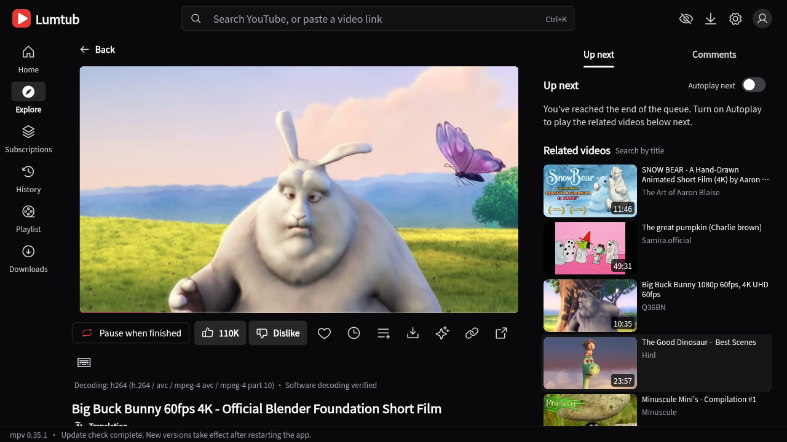
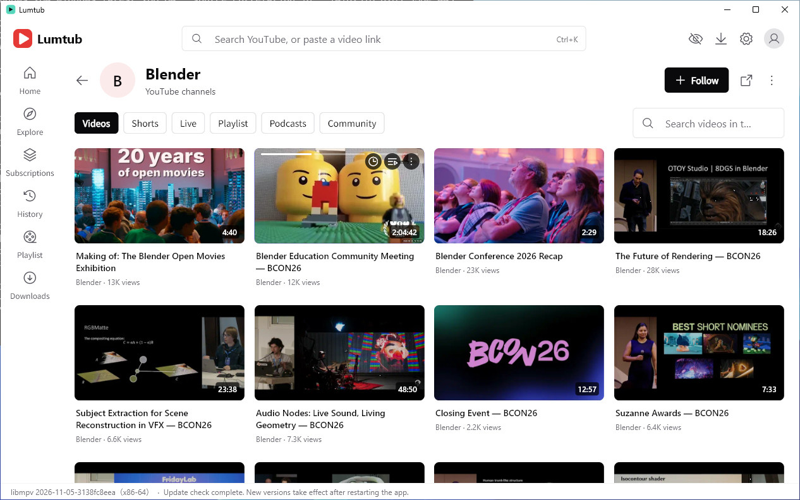
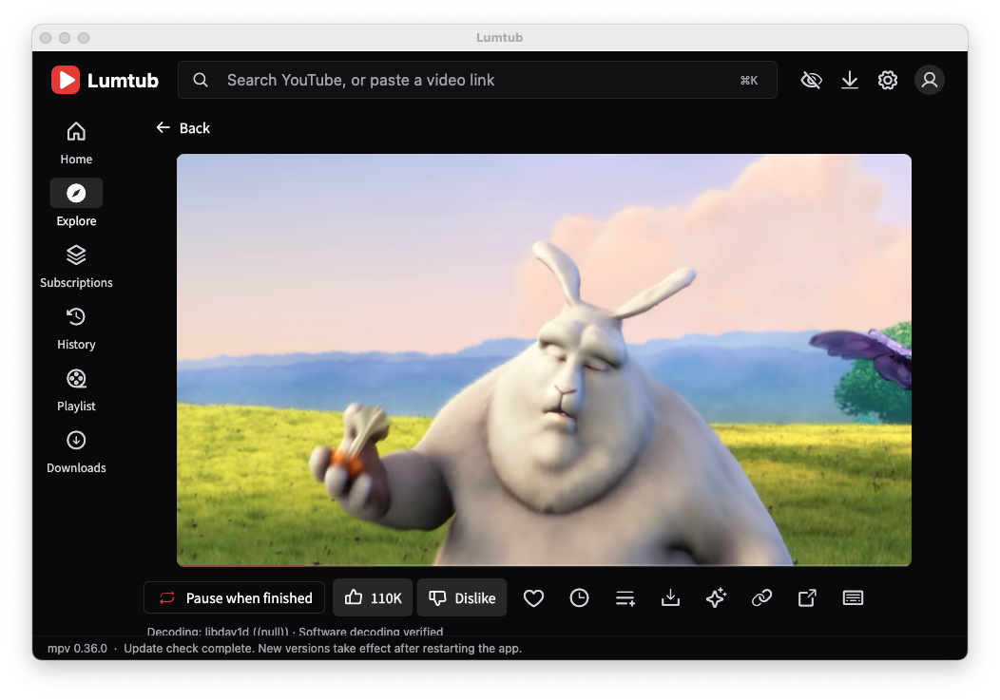
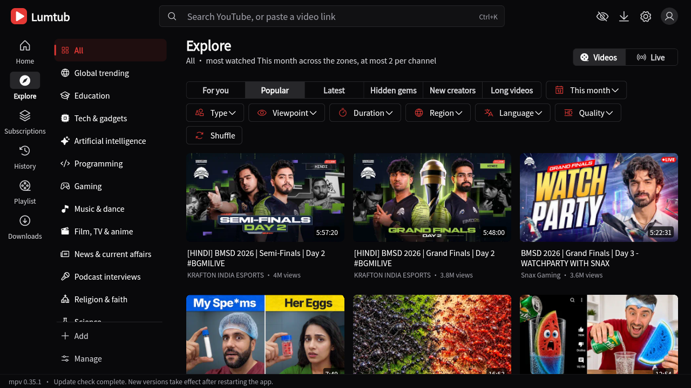
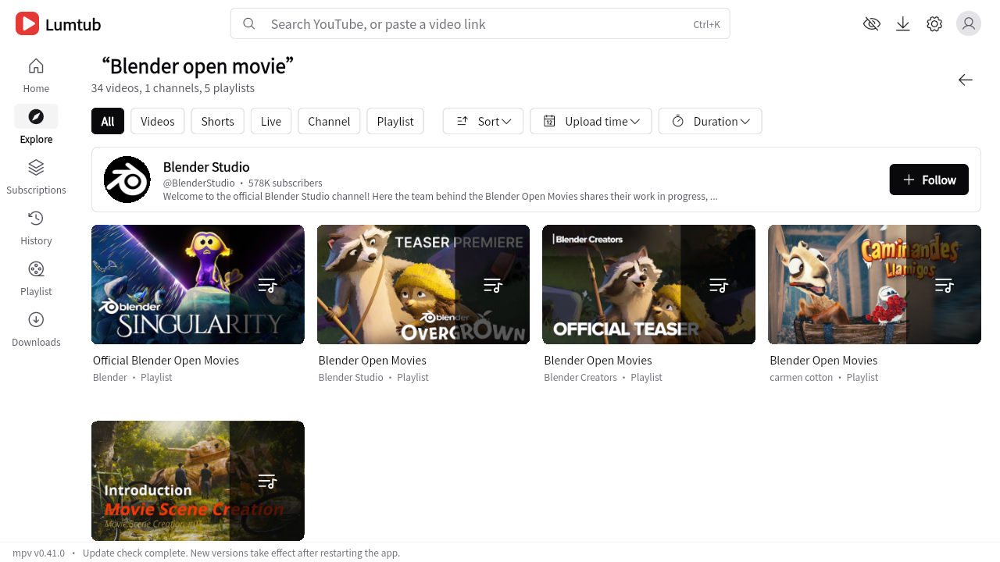
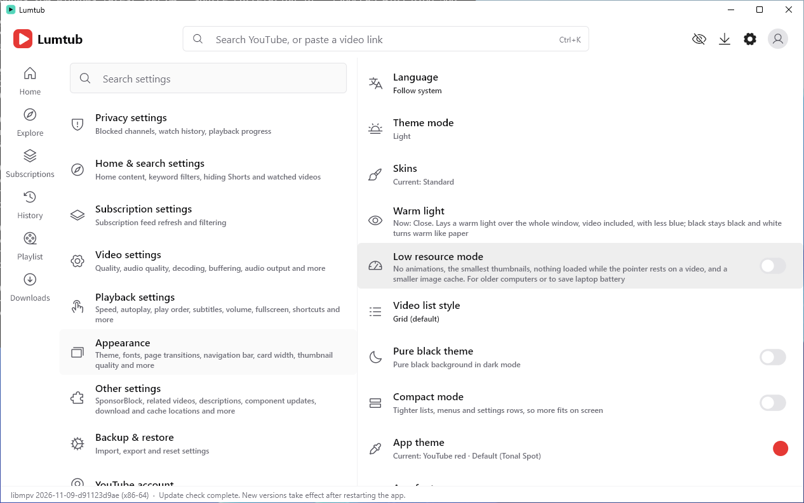
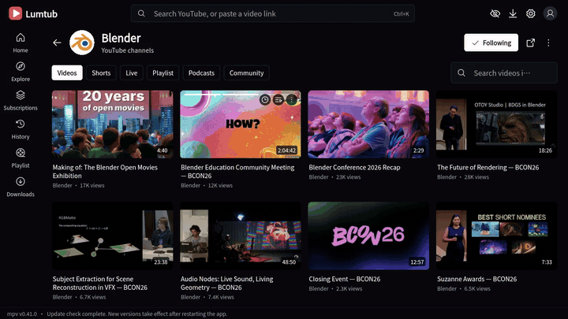

<div align="center">

# ▶ Lumtub

### The YouTube app YouTube never made for your desktop.

**No ads in the way. No browser eating your RAM. No feed that follows you around.**<br>
A real native player with danmaku, bilingual subtitles, AI summaries and a recommendation feed that lives only on your computer.<br>
For **Windows, Linux and macOS**.

[](https://github.com/0x696c757a696f/lumtub/releases/latest)
[](https://github.com/sponsors/0x696c757a696f)

[](https://github.com/0x696c757a696f/lumtub/actions/workflows/build.yml)


[](LICENSE)
[](https://hosted.weblate.org/engage/lumtub/)



https://github.com/user-attachments/assets/4ec072a1-6496-46b2-bcba-9b29df811646

[Pain points](#the-things-youve-put-up-with-for-years) · [Why people switch](#why-people-switch) · [Features](#features) · [Get it](#get-it) · [Privacy](#privacy-you-can-check) · [FAQ](#faq) · [Support](#support-lumtub)

</div>

---

## The things you've put up with for years

Every YouTube viewer knows these. None of them is hard to fix; they just aren't fixed in the browser.

| You know this one | What Lumtub does |
|---|---|
| 🔥 **The laptop fan takes off at 1080p.** The browser picks AV1 or VP9 even when your GPU can't decode it, and the CPU does the work. | Lumtub tests what **your** graphics card decodes in hardware and only picks those codecs. Same picture, a fraction of the power. |
| 🕳️ **One curious click and your feed is ruined for a week.** | The For you feed is worked out **on your computer**, every card says why it's there, and "Not interested" actually removes the reason. |
| 🗣️ **"This video is sponsored by…", "smash that like button", a 40-second intro.** | **SponsorBlock** skips them for you, by the community's timestamps. |
| 😱 **Shocked faces and ALL-CAPS titles that lie.** | **DeArrow** swaps in honest titles and thumbnails written by other viewers. |
| 🤖 **AI-generated slop everywhere.** | An opt-in **AI filter** hides videos labelled as AI and channels on community AI-slop lists. |
| 📱 **Shorts in your search, your subscriptions, your home page.** | **Hide all Shorts**, everywhere, with one switch. |
| 👎 **The dislike count is gone, so you can't spot the scam tutorial.** | **Return YouTube Dislike** brings back an estimate. |
| 🌍 **"Italian" search results full of English, auto-dubbed audio instead of the real voice.** | Filter by the language people **actually speak**, checked from the audio and captions, and the original audio track plays first. |
| 🈶 **Foreign videos give you one subtitle at a time, machine-translated line by line.** | **Two subtitles at once**, AI translation with context, and speech-to-text when a video has no subtitles at all. |
| 💬 **Live chat flies past at 1,000 messages a minute.** | **Danmaku** across the picture, or a chat that holds still while you read. |
| 💾 **Saving a video for the train needs Premium.** | Download any format YouTube really has, joined without re-encoding, and play it offline in the app. |
| 🎧 **Music stops when you minimise the window.** | **Background playback** from the tray, media keys included. |
| 🕵️ **Everything you watch builds a profile of you.** | No account needed and no telemetry. Your history, searches and recommendations never leave your computer. |

## Why people switch

|  | YouTube in a browser | **Lumtub** |
|---|---|---|
| Player | Web player, software fallback, tab throttling | **mpv with hardware decoding**, smooth 4K, HDR and 60 fps |
| Memory | A whole Chromium per tab | **Native app**, no browser inside |
| Recommendations | Built from everything Google knows about you | **Worked out on your own computer**, every card says why |
| Subtitles | One language at a time | **Two at once**, plus AI translation and speech-to-text when a video has none |
| Live chat | Side panel only | Side panel, theater column **or danmaku across the picture** |
| Sponsor segments, AI slop | Extensions you install and trust yourself | **Built in**, all opt-in |
| Downloads | Not for free | **Any format the video really has**, no re-encoding |

Lumtub is free, open source and has no ads, accounts or telemetry of its own.

## Features

<table>
<tr>
<td align="center"><br><b>Windows</b></td>
<td align="center"><br><b>macOS</b></td>
<td align="center"><br><b>Linux</b></td>
</tr>
<tr>
<td align="center"><br>Search that finds channels and playlists too</td>
<td align="center"><br>Palettes, warm light, compact and low-resource modes</td>
<td align="center"><br>Ten palettes, light and dark</td>
</tr>
</table>

### 🎬 A player that respects your hardware
- **Hardware decoding tuned to your GPU.** Lumtub probes what your graphics card really decodes and picks H.264, VP9 or AV1 to match, so 4K stays smooth on a laptop.
- **Live streams up to their best quality**, 1440p and 4K included, starting right at the live edge.
- **Theater mode, mini player, borderless picture-in-picture** that stays on top.
- **Lights off**, A-B loop, double-tap to seek, wheel or swipe for brightness and volume, storyboard previews and the "most replayed" heatmap.
- **Speed and volume remembered per channel.** Podcasts at 1.5×, music at 1×, automatically.
- **Cast** to Chromecast and DLNA TVs. Windows media keys and a tray icon.

### 💬 Subtitles and translation, done properly
- **Bilingual subtitles:** original on one line, your language on the other, with styles you can tune live.
- **Immersive translation** of titles, descriptions, comments, posts and live chat, so foreign-language channels read like local ones.
- **AI translation** with sentence context, using machine translation services or any OpenAI-compatible model you choose.
- **Speech-to-text subtitles** for videos that have none (Groq, OpenAI or your own endpoint).
- **Translate chapter names** in one click.

### 🧠 Smarter, not creepier
- **"For you" feed computed locally.** It mixes your long-term interests, recent ones, exploration and what's popular, and tells you why each video is there. "Not interested" works.
- **AI summaries** of a video from its subtitles, before you spend 40 minutes on it.
- **AI filter (opt-in):** hide videos labelled as AI-generated and channels on community AI-slop lists.
- **Focus mode** hides the home feed, comments and related videos when you just want to watch.
- **Watch statistics** stay on your computer and show where your time goes.

### 🔴 Live, like it should be
- **Danmaku**: live chat and chat replays fly across the picture, Bilibili style, with a thin outline that stays readable.
- **Chat that keeps up**: newest at the bottom, holds still while you scroll up, translate any message.
- **Write in chat** after an optional sign-in.
- **Live markers** on your subscriptions show who is streaming right now.

### 🧭 Find things worth watching
- **Explore by category**, Bilibili style: dozens of zones with sub-categories, sorted by For you, Popular, Latest, Hidden gems, New creators or Long videos.
- **Filter by spoken language**, not just title. Lumtub checks the audio and captions of every result, so "Italian" means people speaking Italian.
- **Filter by region, quality (4K, HDR), length and type.** Add your own zones.
- **Channel pages** with videos, Shorts, live, playlists, podcasts and community posts, plus search inside the channel.
- **Subscription groups**, playlists with total and remaining length, watch later and a play queue.

### ⬇️ Downloads that just work
- Pick any format YouTube really serves; video and audio are joined without re-encoding.
- Downloaded videos play inside Lumtub, offline.

### 🔐 Accounts only if you want them
- **Google sign-in** for subscriptions, playlists, likes, comments and saving to YouTube playlists.
- **TV-code or browser sign-in** for community posts, polls, comment likes and **members-only videos** you have access to.
- Credentials are encrypted on your computer, protected by TPM or Windows Hello on Windows and the keyring on Linux and macOS.

### ⚙️ Small things that add up
- SponsorBlock, Return YouTube Dislike and DeArrow built in, all off by default.
- Proxy support (system, HTTP or SOCKS5) and optional encrypted DNS.
- Accent colours, fonts and card sizes.
- Block any channel, or just stop it being recommended.
- **72 interface languages**, from Arabic and Hebrew (right to left) to Zulu, Esperanto and Latin, following your system language. Improve them on [Weblate](https://hosted.weblate.org/engage/lumtub/).
- Ten restrained palettes, light and dark, plus an optional warm light for the evening.
- Signed automatic updates for the app, yt-dlp and libmpv, with rollback if a new component breaks.

## Get it

<div align="center">

**[⬇ Download the latest release](https://github.com/0x696c757a696f/lumtub/releases/latest)**

</div>

| Package | For |
|---|---|
| `windows-x64-v3` | Most PCs from 2015 on (AVX2) — **pick this if unsure** |
| `windows-x64` | Older x64 CPUs |
| `windows-arm64` | Windows on ARM laptops |
| `linux-x64` AppImage | 64-bit PCs with glibc 2.36 or newer (Debian 12, Ubuntu 24.04, Fedora 37 and later) |
| `linux-arm64` AppImage | ARM64 Linux, such as a Raspberry Pi 5 |
| `macos-arm64` DMG | Macs with Apple silicon (M1 and later) |
| `macos-x64` DMG | Intel Macs |

**Windows:** use the installer, or unzip the portable version and run `lumtub.exe`. No administrator rights needed.<br>
**Linux:** make the AppImage executable (`chmod +x Lumtub_*.AppImage`) and run it. It updates itself in place.<br>
The first start downloads yt-dlp and Deno from GitHub; after that Lumtub keeps itself up to date.

**macOS:** open the DMG and drag Lumtub into Applications. Lumtub is not notarized by Apple yet, so macOS stops it the first time it opens. Either run this once in Terminal:

```sh
xattr -dr com.apple.quarantine /Applications/Lumtub.app
```

or open it, click **Done**, and choose **Open Anyway** next to Lumtub in **System Settings › Privacy & Security**. Updates after that open normally.

## Privacy you can check

🔒 Your recommendations, history, searches, statistics and "Not interested" choices never leave your computer. Lumtub never reads your browser's cookies or profiles. The optional browser sign-in opens a separate, temporary window, keeps only YouTube's cookies, encrypts them on your computer and deletes everything else. Syncing your watch history to YouTube is off unless you turn it on.

Videos play straight from YouTube. Only if you pick a Piped or Invidious server, or YouTube refuses and Lumtub falls back to one, does that server see which video you watch.

Everything is open source under the GPL, so none of this has to be taken on trust.

## FAQ

**Is it free?** Yes, and it stays free. No ads, no paid tier, no data sold. It's funded by [sponsors](#support-lumtub).

**Will it break when YouTube changes something?** Sometimes, briefly. Lumtub updates yt-dlp on its own, and fixes usually arrive within days.

**Do I need a Google account?** No. Everything except account features (likes, comments, syncing) works signed out.

**Where is my data?** On Windows in `%LOCALAPPDATA%\Lumtub`, or the `userdata` folder next to `lumtub.exe` for the portable version. On Linux in `~/.local/share/lumtub`, on macOS in `~/Library/Application Support/Lumtub`. Settings can be exported and imported.

**Which Linux systems does it run on?** Any distribution with glibc 2.36 or newer: Debian 12, Ubuntu 24.04, Fedora 37 and later. Ubuntu 22.04 and older, and musl systems such as Alpine, are not supported. On NixOS start it with `appimage-run`.

**Why is there no tray icon on GNOME?** GNOME shows tray icons only with the AppIndicator extension. Ubuntu has it built in; on Fedora and other plain GNOME installs, add [AppIndicator and KStatusNotifierItem Support](https://extensions.gnome.org/extension/615/appindicator-support/). Without it, closing or minimizing to the tray minimizes the window normally instead.

**Why does Linux forget my sign-in?** Lumtub keeps it encrypted in the system keyring (GNOME Keyring or KWallet). A desktop without one, such as a bare window manager, needs `gnome-keyring` or `kwallet` installed and running.

**Was this called YTPlus?** Yes, until October 2026. Updating keeps your settings, library and sign-in.

## Support Lumtub

<div align="center">

**Lumtub is built by one developer, in the open, with no ads and no tracking.**<br>
Every feature above exists because someone sponsored the time to build it.

<a href="https://github.com/sponsors/0x696c757a696f"></a>

**Monthly sponsors** decide what comes next: Android, a code-signing certificate so Windows stops warning on install, and Apple notarization.<br>
One-time gifts of any amount are just as welcome. The same page is in the app under Settings › About › Support development.

</div>

<details>
<summary><b>Pay with crypto</b> (check that the coin and network match the address; funds sent on the wrong chain cannot be recovered)</summary>

| Coin | Network | Address |
|---|---|---|
| ETH · USDC · USDT | Any EVM chain (Ethereum, Arbitrum, Base, Optimism, Polygon, BNB Chain…) | `0x619FeeF5986b9ed8E75D7CFD67AdB575355b9F80` |
| BTC | Taproot | `bc1p7jf7pzep76cld4pd6xmtfjckpn6qamdqc2rhjus64re2cvuc72sqdwszqc` |
| BTC | Native SegWit | `bc1q4rp3ag5lmnyy8eqwjm9s4xx62uulfr6n43ycvc` |
| BTC | Nested SegWit | `3Lu1yzQYfNZLpvh2dt6T6NuRbtwQkJHmT6` |
| BTC | Legacy | `123mpbi91xQitVkh9oosY4VczFqJB9kjDQ` |
| USDT | Tron (TRC-20) | `TBHXcP2ReM5sqpRDTyrL1UWtcSmYeyrmnB` |
| USDT | Solana (SPL) | `4s6uaauKCgwSNVzb5Lq1kxUe9dpm8V64D6FPw7hTwrQ6` |

</details>

Can't give money? ⭐ Star the repository, tell a friend, [report a bug or suggest an idea](https://github.com/0x696c757a696f/lumtub/issues), or [translate Lumtub](https://hosted.weblate.org/engage/lumtub/). It all helps.

---

<details>
<summary><b>For developers: building, Google OAuth client, translations</b></summary>

### Building

Every push and pull request to `main` builds on GitHub Actions (`.github/workflows/build.yml`): a verified libmpv per CPU, the Rust core in `native/lumtub_core` (fat LTO), `flutter analyze`, the unit tests, a portable ZIP and an Inno Setup installer for x64, x64-v3 and arm64. Releases are made by the Create release workflow and carry signed packages.

Locally you need Flutter 3.47, Visual Studio with the C++ desktop workload, and Rust:

```powershell
flutter pub get
cargo build --release --manifest-path native/lumtub_core/Cargo.toml
flutter test
flutter build windows --release
```

### Your own Google OAuth client

1. In Google Cloud Console, create an OAuth client of type "Desktop app" and enable YouTube Data API v3.
2. Enter its client ID and secret under Settings › YouTube account, or build them in with the repository secrets `YTPLUS_GOOGLE_CLIENT_ID` and `YTPLUS_GOOGLE_CLIENT_SECRET`.
3. An unreviewed client makes Google warn that the app is unverified; continue past it.

### Translations

Source strings are English wrapped in `tr('…')`; translations, simplified Chinese included, live in `assets/l10n` keyed by that English text and are managed on [Weblate](https://hosted.weblate.org/engage/lumtub/). See [TRANSLATING.md](TRANSLATING.md).

</details>

## License and attribution

Lumtub is licensed under the GNU General Public License, version 3 or later (`GPL-3.0-or-later`).

The settings tiles in `lib/widgets/pilinara_settings_tiles.dart` are adapted from [PiliNara](https://github.com/Starfallan/PiliNara), copyright its contributors, and remain under GPL-3.0-or-later; parts of Lumtub's interface follow PiliNara's design. `vendor/pilinara-settings/` and `vendor/pilinara-player/` are unmodified PiliNara snapshots kept for reference and not built. `vendor/media_kit_video/` is a modified copy of media_kit_video (see its `LUMTUB.md`).

Built on [media_kit](https://github.com/media-kit/media-kit), [mpv](https://mpv.io), [yt-dlp](https://github.com/yt-dlp/yt-dlp) and [FFmpeg](https://ffmpeg.org). AI channel lists come from [KillSlop](https://killslop.app) (CC BY-SA 4.0) and [AiSList](https://github.com/Override92/AiSList) (CC BY-NC 4.0), downloaded at runtime and not shipped with Lumtub. The bundled Noto Sans SC font is under the SIL Open Font License 1.1 (`assets/fonts/OFL.txt`); the Phosphor icon fonts are under the MIT License (`assets/fonts/phosphor/LICENSE`). Other packages and components keep their own licenses; see `NOTICE` before redistributing.

Lumtub is not affiliated with or endorsed by YouTube or Google.
