<div align="center">


# Lumtub

**Watch YouTube your way.**<br>
No ads, mpv playback, recommendations that say why, two subtitles at once and live chat as danmaku.<br>
No account needed to watch.

**English** · [简体中文](README.zh-Hans.md)

[](https://github.com/0x696c757a696f/lumtub/releases/latest)
[](https://github.com/0x696c757a696f/lumtub/releases)
[](https://github.com/0x696c757a696f/lumtub/actions/workflows/build.yml)
[](LICENSE)
[](https://hosted.weblate.org/engage/lumtub/)
[](https://github.com/0x696c757a696f/lumtub/stargazers)
<a href="#support-lumtub"></a>

#### Download

<a href="https://github.com/0x696c757a696f/lumtub/releases/latest"></a>
<a href="https://github.com/0x696c757a696f/lumtub/releases/latest"></a>
<a href="https://github.com/0x696c757a696f/lumtub/releases/latest"></a>
<a href="https://github.com/0x696c757a696f/lumtub/releases/latest"></a>
<a href="https://github.com/0x696c757a696f/lumtub/releases/latest"></a>

<sub>Free, open source, no telemetry. Which file to pick: <a href="#get-it">Get it</a>. iPhone and iPad are in preview.</sub>

⭐ **Like Lumtub? Star it on GitHub (top right of this page).** It costs nothing and is the main way new people find it.

https://github.com/user-attachments/assets/97e3ce09-8e66-43fe-9125-bff1b3dcb3fe

[Learn languages](#-learn-languages-from-real-videos) · [Screenshots](#screenshots) · [Features](#features) · [Get it](#get-it) · [Data](#where-the-data-comes-from) · [Privacy](#privacy-what-stays-local-and-what-doesnt) · [FAQ](#faq) · [Support](#support-lumtub)

</div>
---

## What makes Lumtub different

- **Recommendations you can read and steer.** The For you feed is computed on your computer from your own history. Every card says why it is there, and "Not interested" removes that reason instead of being ignored.
- **mpv playback that checks your hardware.** Videos play through mpv and libmpv, not a web page. Lumtub tests which codecs your GPU really decodes and prefers those formats, to avoid software decoding where hardware decoding is available. The Stats overlay shows what is actually in use. Real CPU, memory and battery use depend on your hardware, the video format and the features you turn on.
- **Watch in any language.** The original audio track plays first. Show two subtitles at once (original and your language), translate with sentence context, and generate subtitles for videos that have none. Titles, descriptions, comments and chat can be translated too. Translation, speech-to-text and summaries are optional and may use a third-party service or your own API key.
- **Live chat on the video.** Chat and chat replays can fly across the picture as danmaku, Bilibili style, or stay in a side panel that holds still while you read.
- **No account to watch.** Search, playback, subscriptions and recommendations work signed out. Sign in only for likes, comments, playlists, members-only videos and other interaction.

Lumtub is free and open source, with no ads, no accounts of its own and no telemetry.

## 🆕 Learn languages from real videos

**Learn languages from the videos you already love.** Look up as you watch · listen line by line · save and review · offline dictionaries.

**Tap any word in the subtitles to look it up. Chinese gets pinyin and Japanese gets kana above the line. Save a word with its sentence and the original audio, and send it to Anki in one click. Offline dictionaries, one payment.**

<p align="center">
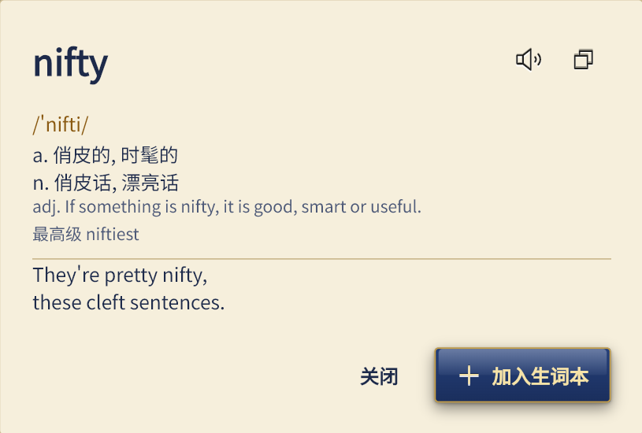

</p>
<p align="center"><sub>Real screenshots from the preview build, Chinese interface.</sub></p>

**Learning Pack** (preview, Windows, macOS and Linux):

- **Tap a word, get the meaning**, from dictionaries that download once and then work offline. Chinese, English, Japanese and Korean; Spanish, French, German, Italian and Russian in beta.
- **Readings above the line**: pinyin for Chinese, kana for Japanese, romanization for Korean.
- **Words above your level are highlighted**, so you only stop for the ones you don't know yet.
- **Vocabulary book** that keeps the sentence, the original audio and the moment in the video. Tap an entry to hear it again.
- **Send to Anki** in one click, or export CSV.

**Try it free:** your first 30 word lookups have everything switched on, no account needed. After that, without the pack, you can look up 3 words a day. [Install guide and refunds](https://0x696c757a696f.github.io/lumtub/learn/).<br>
**Early-bird price:** ¥99 until 3 December, then ¥129. Pay once, no subscription, on [爱发电](https://afdian.com/item/1257acd0e5cc11f1a9d05254001e7c00) (Alipay or WeChat Pay). Card payment is coming later. One license for up to 5 of your devices; the app checks it online about once every 30 days.

**Free for everyone**, in the Subtitles menu under **Language learning**:

- **Pause after each line** (Q): playback stops when a line ends, so you have time to understand it before you move on.
- **Blur the translation** (V): the second subtitle stays blurred until you hover it, tap it or press the key. Guess first, then check.
- **Replay, loop and step through lines** (R, Shift+R, A, D): every jump goes by subtitle line and starts playing.
- **Shadowing** (E): record yourself saying the line, then hear the original and your take one after the other. Recordings stay on your device.
- **Export the subtitle list as CSV**, every line with its translation, for Anki or a spreadsheet.

Combined with two subtitles at once and Explore by spoken language, this turns any video into listening practice. Touch screens and TV remotes get buttons for all of it.

## Screenshots

<table>
<tr>
<td align="center" width="50%">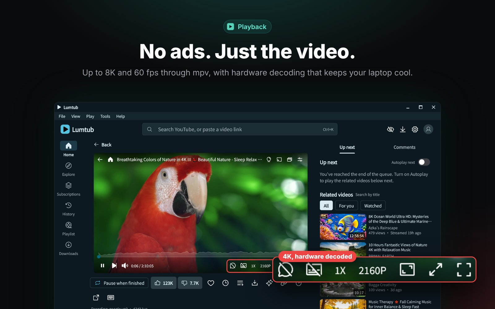</td>
<td align="center" width="50%">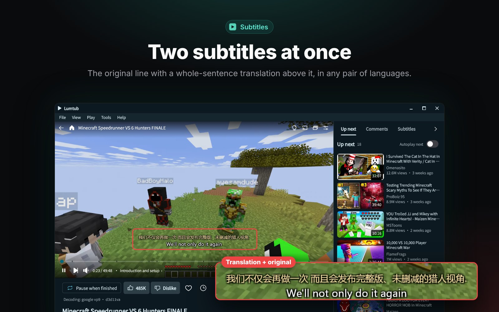</td>
</tr>
<tr>
<td align="center" width="50%">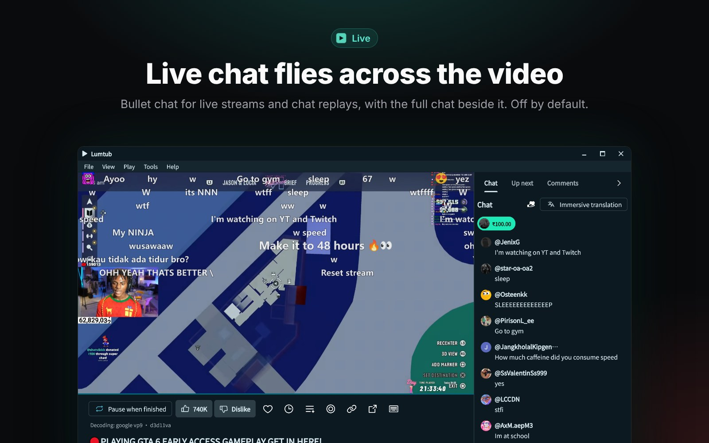</td>
<td align="center" width="50%">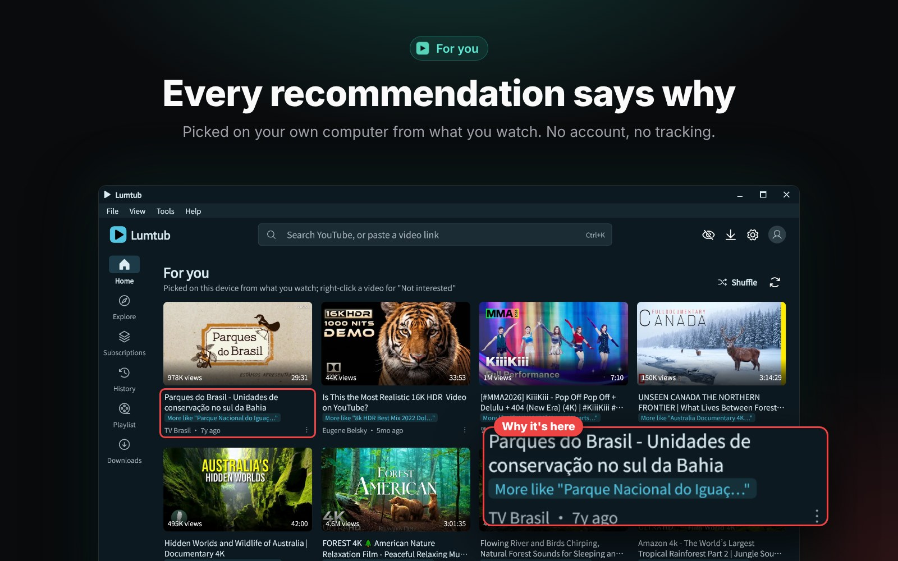</td>
</tr>
<tr>
<td align="center" width="50%">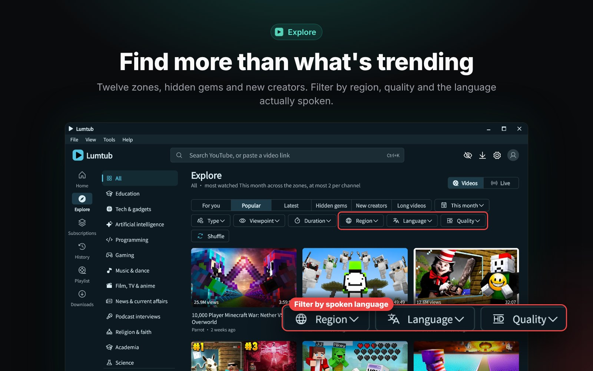</td>
<td align="center" width="50%">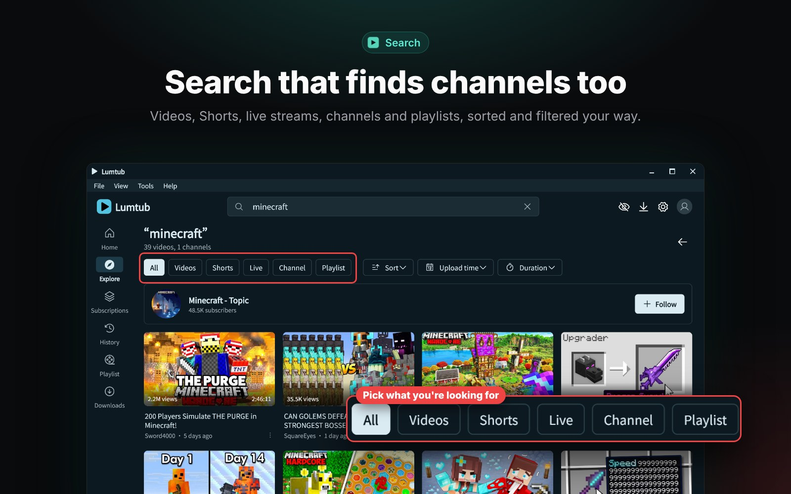</td>
</tr>
<tr>
<td align="center" width="50%">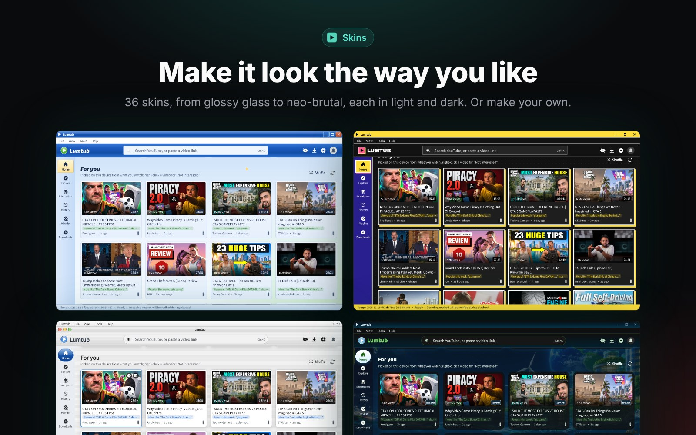</td>
<td align="center" width="50%">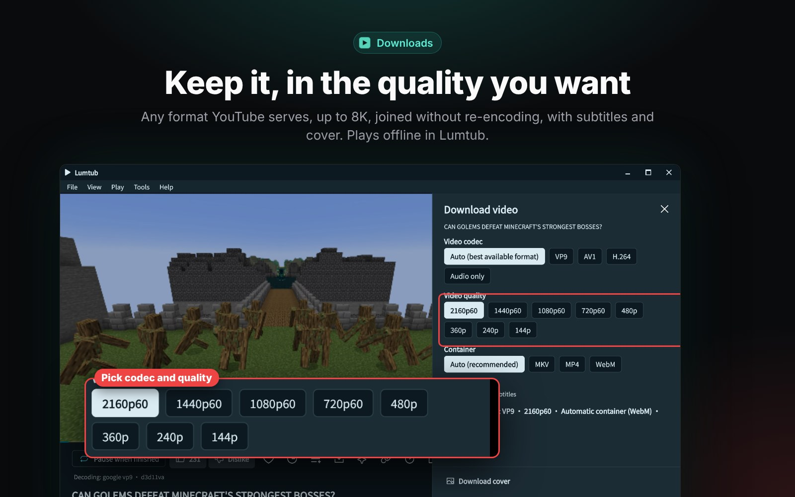</td>
</tr>
<tr>
<td align="center" width="50%" colspan="2">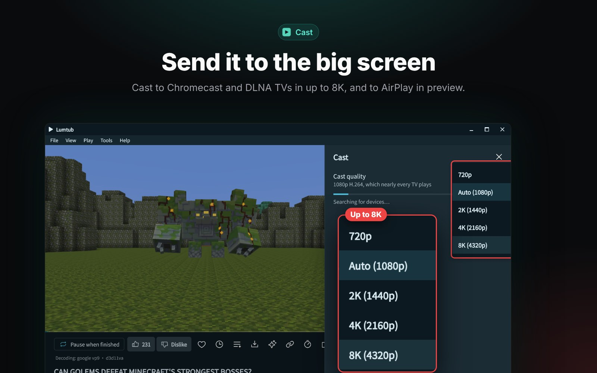</td>
</tr>
</table>

## Features

### 🧠 Recommendations and discovery
- **"For you" feed computed locally**, mixing long-term interests, recent ones, exploration and what's popular, with the reason shown on each video.
- **Explore by category**, Bilibili style, sorted by For you, Popular, Latest, Hidden gems, New creators or Long videos. Filter by spoken language (checked from audio and captions), region, quality, length and type, and add your own zones.
- **Channel pages** with videos, Shorts, live, playlists, podcasts and community posts, plus search inside the channel.
- **Subscription groups**, playlists with total and remaining length, watch later and a play queue.
- 🆕 **Bring your subscriptions along** from NewPipe, FreeTube, Google Takeout or OPML without signing in, and export them again, or back up your whole library with your settings.
- **Focus mode** hides the home feed, comments and related videos. **Watch statistics** stay on your computer.

### 🎬 Player
- Hardware decoding matched to your GPU; live streams at their best quality, starting at the live edge.
- Theater mode, mini player, borderless picture-in-picture, lights off, A-B loop, storyboard previews and the "most replayed" heatmap. Subtitles in picture-in-picture and the mini player can be turned off.
- Speed and volume remembered per channel; background playback with media keys and a tray icon.
- 🆕 **Volume balance** (off by default) evens out loudness between videos and within one, using the loudness YouTube measured.
- The mouse wheel over the video can change the volume or brightness if you want it to (Settings › Controls & shortcuts); otherwise it just scrolls the page. Ctrl + wheel changes the speed.
- **Cast** to Chromecast and DLNA TVs, and to AirPlay receivers (preview).
- **Diagnostics:** a network check of the proxy, exit addresses and each kind of request, and a built-in playback test of H.264, VP9 and AV1 on your computer (processor, memory, dropped frames).
- 🆕 **Downloads:** pick any format YouTube serves, joined without re-encoding, with subtitles (bilingual too), title and cover inside, sponsor segments cut out if you like, and play it offline in Lumtub. Live streams can be recorded as they air.

### 💬 Subtitles and translation
- **Bilingual subtitles** with styles you can tune live, and one-click translation of chapter names.
- **AI translation** through machine translation services (🆕 MyMemory included, free and without a key) or any OpenAI-compatible model you choose.
- **Speech-to-text subtitles** (Groq, OpenAI or your own endpoint) and **AI summaries** of a video from its subtitles. These need a service or API key that you provide, and some providers charge.

### 🔴 Live
- Danmaku for live chat and replays, or a chat that keeps up: newest at the bottom, translate any message, write in chat after signing in.
- Live markers on your subscriptions.
- Super Chat and channel memberships open YouTube's payment pages in your browser.

### 🔐 Accounts only if you want them
- 🆕 **One sign-in**: sign in once in a browser window, and your home feed, history, Watch Later, playlists, likes, comments, subscriptions, community posts, polls and **members-only videos** you have access to all work. Google sign-in with your own client stays optional.
- Credentials are encrypted on your computer, protected by TPM or Windows Hello on Windows and the keyring on Linux and macOS.
- 🆕 **Post-quantum encryption:** HTTPS connections Lumtub makes itself (YouTube's pages and data, the stream relay, encrypted DNS, updates) use the hybrid X25519MLKEM768 key exchange where the server supports it, as YouTube's do. Settings › Network shows what each site agreed on, and can require it or turn it off. The video player's and yt-dlp's own connections are not covered.

### Also built in
These are also found in other YouTube clients, and all are opt-in here:
- **SponsorBlock**, **DeArrow** titles and thumbnails, **Return YouTube Dislike**, hide all Shorts, and an AI filter that hides videos labelled as AI and channels on community AI-slop lists.
- Proxy support (system, HTTP or SOCKS5), optional encrypted DNS, and Piped or Invidious servers as a fallback. 🆕 When YouTube shows a bot check, Lumtub switches between IPv4 and IPv6 by itself.
- 🆕 YouTube's JavaScript challenges are solved inside Lumtub with its built-in QuickJS on computers, with Deno as a fallback.
- **82 interface languages**, right to left included, following your system language. Improve them on [Weblate](https://hosted.weblate.org/engage/lumtub/).
- **Skins** that change the whole look, 36 built in, from Y2K gloss and Frutiger Aero scenes to one-bit pixels, clay and neo-brutalism, with their own title bar and menu bar if you like. Anyone can make one: a commented `skin.jsonc` file, checked for readable contrast. See [skins/README.md](skins/README.md).
- Ten colour schemes, light and dark, plus an optional warm light, fonts and card sizes.
- 🆕 **Window transparency**: see the desktop through the window like glass, under any skin, with an optional blur.
- Block any channel, or just stop it being recommended.
- **Block lists** for controversial religious groups and state propaganda media, off until you turn them on. They are public files in [lists/](lists/), updated daily with signatures, and anyone can suggest a channel or report a mistake. See [lists/README.md](lists/README.md).
- Signed automatic updates for the app, yt-dlp and libmpv, with rollback if a new component breaks.

## Get it

<div align="center">

**[⬇ Download the latest release](https://github.com/0x696c757a696f/lumtub/releases/latest)**

</div>

| Package | For | Download |
|---|---|---|
| `windows-x64-v3` | Most PCs from 2015 on (AVX2) — **pick this if unsure** | [⬇ Installer](https://lumtub.app/get/?windows-x64-v3-setup.exe) · [Portable ZIP](https://lumtub.app/get/?windows-x64-v3.zip) |
| `windows-x64` | Older x64 CPUs | [⬇ Installer](https://lumtub.app/get/?windows-x64-setup.exe) · [Portable ZIP](https://lumtub.app/get/?windows-x64.zip) |
| `windows-arm64` | Windows on ARM laptops | [⬇ Installer](https://lumtub.app/get/?windows-arm64-setup.exe) · [Portable ZIP](https://lumtub.app/get/?windows-arm64.zip) |
| `linux-x64-v3` AppImage | Most 64-bit PCs from 2015 on (AVX2) with glibc 2.35 or newer — **pick this if unsure** | [⬇ AppImage](https://lumtub.app/get/?linux-x64-v3.AppImage) |
| `linux-x64` AppImage | 64-bit PCs with glibc 2.35 or newer (Ubuntu 22.04, Debian 12, Fedora 36 and later) | [⬇ AppImage](https://lumtub.app/get/?linux-x64.AppImage) |
| `linux-arm64` AppImage | ARM64 Linux, such as a Raspberry Pi 5 | [⬇ AppImage](https://lumtub.app/get/?linux-arm64.AppImage) |
| `linux-x64` / `linux-arm64` Flatpak | The same, as a Flatpak bundle (no self-update: install the next one by hand) | [Release page](https://github.com/0x696c757a696f/lumtub/releases/latest) |
| `macos-arm64` DMG | Macs with Apple silicon (M1 and later) | [⬇ DMG](https://lumtub.app/get/?macos-arm64.dmg) |
| `macos-x64` DMG | Intel Macs | [⬇ DMG](https://lumtub.app/get/?macos-x64.dmg) |
| `android-arm64-v8a` APK | Most Android phones, tablets and TVs (Android 7.0 or newer) — **pick this if unsure** | [⬇ APK](https://lumtub.app/get/?android-arm64-v8a.apk) |
| `android-armeabi-v7a` APK | Older 32-bit Android devices and many low-cost TV boxes | [⬇ APK](https://lumtub.app/get/?android-armeabi-v7a.apk) |
| `android-x86_64` APK | Android emulators and x86 Chromebooks | [⬇ APK](https://lumtub.app/get/?android-x86_64.apk) |
| `ios` IPA | iPhone and iPad with iOS 15 or newer (preview, sideloaded) | [⬇ IPA](https://lumtub.app/get/?ios.ipa) |
| `ios-trollstore` TIPA | The same for [TrollStore](https://github.com/opa334/TrollStore): also asks iOS for VP9 hardware decoding before iOS 26.2 | [⬇ TIPA](https://lumtub.app/get/?ios-trollstore.tipa) |

The links in the table always give the newest version. On the release page, file names follow `Lumtub_<version>_<platform>`, for example `Lumtub_0.2.29-abc1234_windows-x64-v3-setup.exe`.<br>
**Windows:** use the installer, or unzip the portable version and run `lumtub.exe`. No administrator rights needed. Package manager (under review, working once accepted): `winget install Lumtub.Lumtub`.<br>
Windows may show **Windows protected your PC** the first time, because the installer isn't signed with a paid code-signing certificate yet. Click **More info**, then **Run anyway**. Do this only for a file you downloaded from the official places below.<br>
**Linux:** make the AppImage executable (`chmod +x Lumtub_*.AppImage`) and run it. It updates itself in place. If it says FUSE is missing, install your distribution's `fuse3` package, or start it with `--appimage-extract-and-run`. Prefer Flatpak? `flatpak install --user Lumtub_*_linux-x64.flatpak`.<br>
The first start downloads yt-dlp and Deno from GitHub; after that Lumtub keeps itself up to date.<br>
**Android (preview):** open the APK and allow installing from your browser or file manager when asked. New versions install from inside Lumtub; Android asks you to confirm. Live streams and downloads work too, through the yt-dlp built into the app; members-only videos don't play on Android yet.<br>
**iPhone and iPad (preview, not yet tested on a real device):** Lumtub isn't in the App Store, so install the IPA with [SideStore](https://sidestore.io), [AltStore](https://altstore.io) or Sideloadly using your own Apple ID, or with TrollStore. In SideStore or AltStore, add the source `https://github.com/0x696c757a696f/lumtub/releases/latest/download/altstore-source.json` to get new versions. yt-dlp runs inside the app with the Python it carries.

**macOS:** open the DMG and drag Lumtub into Applications. Lumtub is not notarized by Apple yet, so macOS stops it the first time it opens. Either run this once in Terminal:

```sh
xattr -dr com.apple.quarantine /Applications/Lumtub.app
```

or open it, click **Done**, and choose **Open Anyway** next to Lumtub in **System Settings › Privacy & Security**. Updates after that open normally.


### Official downloads only

Lumtub is free. It comes only from:
- [GitHub Releases](https://github.com/0x696c757a696f/lumtub/releases) of this repository,
- the website [lumtub.app](https://lumtub.app/), which links to the same files,
- Lumtub's built-in updater, which downloads from those releases,
- the SideStore/AltStore source above, and `winget install Lumtub.Lumtub` once it's accepted.

To check a download, compare its SHA-256 with the one GitHub shows next to the file on the [release page](https://github.com/0x696c757a696f/lumtub/releases/latest). On Windows: `Get-FileHash <file>` in PowerShell; on macOS and Linux: `shasum -a 256 <file>`.

The optional [Learning Pack](#-learn-languages-from-real-videos) is sold only through 爱发电, from the links in this README, the website and the app. If anyone else asks you to pay for Lumtub, or sells a renamed copy without its source code, it doesn't come from this project and may have been tampered with. Lumtub's license (AGPL) lets others share and even sell copies, but only if they give you the complete source code under the same license and keep the copyright notices. A paid closed-source copy breaks the license. Please [report it in an issue](https://github.com/0x696c757a696f/lumtub/issues/new) with a link, so it can be taken down.

## Where the data comes from

- **Videos, search, channels, comments and live chat** come from YouTube itself, through [yt-dlp](https://github.com/yt-dlp/yt-dlp) and YouTube's own web API. No API key is needed to watch.
- **Account features** (likes, comments, playlists, subscriptions) use your own sign-in, through YouTube's API or the YouTube website.
- **Piped or Invidious** servers, only as a fallback you can turn off.
- **SponsorBlock, DeArrow and Return YouTube Dislike**, from their public APIs, when you turn them on.
- **AI channel lists** from [KillSlop](https://killslop.app) and [AiSList](https://github.com/Override92/AiSList), when you turn the AI filter on.
- **Translation, speech-to-text and summaries** from the service or model you choose.

## Privacy: what stays local and what doesn't

Stays on your computer: your watch history, statistics, "Not interested" choices and the recommendation model itself. Recommendations are computed locally. Lumtub never reads your browser's cookies or profiles. The optional browser sign-in opens a separate, temporary window, keeps only YouTube's cookies, encrypts them on your computer and deletes everything else. Syncing your watch history to YouTube is off unless you turn it on.

Leaves your computer, because the feature needs it:
- **YouTube** receives the requests needed to search, load and play videos, and your account actions when signed in. Your search terms go to YouTube like any search.
- **A Piped or Invidious server** sees which video you watch, only if you pick one or YouTube refuses and Lumtub falls back to it.
- **Translation, speech-to-text and AI summaries** send the text or audio involved to the service you configure. All are optional and off until you set them up.
- **SponsorBlock, DeArrow and Return YouTube Dislike** contact their own servers when enabled, using a short hash prefix of the video id where the service supports it.
- **Updates** download from GitHub.

Everything is open source under the AGPL, so none of this has to be taken on trust.

## FAQ

**Is it free?** Yes, and it stays free. No ads, no paid tier, no data sold. It's funded by [sponsors](#support-lumtub).

**Will it break when YouTube changes something?** Sometimes, briefly. Lumtub updates yt-dlp on its own, and fixes usually arrive within days.

**Do I need a Google account?** No. Everything except account features (likes, comments, syncing) works signed out.

**Is everything free?** Lumtub is. Some optional AI features (translation, speech-to-text, summaries) use third-party services or your own API keys, and those providers may charge.

**Where is my data?** On Windows in `%LOCALAPPDATA%\Lumtub`, or the `userdata` folder next to `lumtub.exe` for the portable version. On Linux in `~/.local/share/lumtub`, on macOS in `~/Library/Application Support/Lumtub`. Settings, subscriptions and your library can be exported and imported.

**Why does it stop at 1080p on my older PC or phone?** Above 1080p YouTube only has VP9 and AV1. Lumtub checks at every start whether your device decodes them in hardware; if it decodes neither, automatic quality stays at 1080p (H.264, decoded in hardware everywhere) and Lumtub tells you once. You can still pick 1440p or 4K, or set the playback strategy to Quality first: the picture is then decoded in software, which uses more battery and gets warmer. On iPhone and iPad, iOS 26.2 and later let Lumtub use the VP9 and AV1 hardware decoders the chip has (AV1: iPhone 15 Pro and newer); before 26.2 only the TrollStore build can ask for VP9. Playback info in the player shows what is in use.

**Which Linux systems does it run on?** Any distribution with glibc 2.35 or newer: Ubuntu 22.04, Debian 12, Fedora 36 and later. Ubuntu 20.04 and older, and musl systems such as Alpine, are not supported. On NixOS start it with `appimage-run`.

**Why is there no tray icon on GNOME?** GNOME shows tray icons only with the AppIndicator extension. Ubuntu has it built in; on Fedora and other plain GNOME installs, add [AppIndicator and KStatusNotifierItem Support](https://extensions.gnome.org/extension/615/appindicator-support/). Without it, closing or minimizing to the tray minimizes the window normally instead.

**Why does Linux forget my sign-in?** Lumtub keeps it encrypted in the system keyring (GNOME Keyring or KWallet). A desktop without one, such as a bare window manager, needs `gnome-keyring` or `kwallet` installed and running.

**Was this called YTPlus?** Yes, until October 2026. Updating keeps your settings, library and sign-in.

## Translate

Lumtub speaks 82 languages, all translated by volunteers on [Weblate](https://hosted.weblate.org/engage/lumtub/). Missing your language, or spotted a mistake? Join in there; no coding needed. See [TRANSLATING.md](TRANSLATING.md).

[](https://hosted.weblate.org/engage/lumtub/)

## Support Lumtub

<div align="center">

<a href="https://github.com/sponsors/0x696c757a696f"></a>

<a href="https://github.com/sponsors/0x696c757a696f"></a>
<a href="https://ko-fi.com/0x696c757a696f"></a>
<a href="https://afdian.com/a/linmuqingfeng"></a>

Your support pays for build servers, test devices and developer accounts. First up: a paid Apple Developer account, so sideloaded iOS installs last a full year instead of 7 days.<br>
Feature requests from sponsors carry the **sponsor priority** label and are worked on first.<br>
One-time gifts of any amount are just as welcome. The same page is in the app under Settings › About › Support development.<br>
Thank you to our [supporters](SPONSORING.md#supporters): jay.

</div>

[Ko-fi](https://ko-fi.com/0x696c757a696f) takes one-time gifts by PayPal or card, no GitHub account needed. [Afdian](https://afdian.com/a/linmuqingfeng) takes Alipay and WeChat Pay and never renews on its own: a "monthly" plan is one payment for one month, and a custom amount is a one-time gift. Other ways to give, crypto included, are in [SPONSORING.md](SPONSORING.md).

Can't give money? ⭐ Star the repository, tell a friend, [report a bug or suggest an idea](https://github.com/0x696c757a696f/lumtub/issues), [suggest a channel for the block lists](lists/README.md#suggesting-a-change), or [translate Lumtub](https://hosted.weblate.org/engage/lumtub/). It all helps.

## Disclaimer

Lumtub is an independent project. It is not affiliated with, endorsed by or sponsored by YouTube or Google. It hosts no videos: like a web browser, it shows what YouTube serves to you. Downloading is for personal use where the law and YouTube's terms allow it. If you can, support the creators you watch, through memberships, Super Chat or YouTube Premium. The software is provided as is, without warranty; see [LICENSE](LICENSE).

---

<details>
<summary><b>For developers: building, Google OAuth client, translations</b></summary>

### Building

Every push and pull request to `main` builds on GitHub Actions (`.github/workflows/build.yml`): a verified libmpv per CPU, the Rust core in `native/lumtub_core` (fat LTO), `flutter analyze`, the unit tests, a portable ZIP and an Inno Setup installer for x64, x64-v3 and arm64. Releases are made by the Create release workflow and carry signed packages. Which platforms a change builds, and how to build one alone: [docs/CI.md](docs/CI.md).

Locally you need Flutter 3.47, Visual Studio with the C++ desktop workload, and Rust:

```powershell
flutter pub get
cargo build --release --manifest-path native/lumtub_core/Cargo.toml
flutter test
flutter build windows --release
```

### Your own Google OAuth client

1. In Google Cloud Console, create an OAuth client of type "Desktop app" and enable YouTube Data API v3.
2. Enter its client ID and secret under Settings › YouTube account, or build them in with the repository secrets `YTPLUS_GOOGLE_CLIENT_ID` and `YTPLUS_GOOGLE_CLIENT_SECRET`.
3. An unreviewed client makes Google warn that the app is unverified; continue past it.

### Translations

Source strings are English wrapped in `tr('…')`; translations, simplified Chinese included, live in `assets/l10n` keyed by that English text and are managed on [Weblate](https://hosted.weblate.org/engage/lumtub/). See [TRANSLATING.md](TRANSLATING.md).

</details>

## License and attribution

Lumtub is licensed under the GNU Affero General Public License, version 3 or later (`AGPL-3.0-or-later`). Anyone who runs a modified Lumtub as a network service must also offer its source code to the people who use it. Versions up to and including 0.2.51 were released under `GPL-3.0-or-later`.

`vendor/media_kit_video/` is a modified copy of media_kit_video (see its `LUMTUB.md`).

Built on [media_kit](https://github.com/media-kit/media-kit), [mpv](https://mpv.io), [yt-dlp](https://github.com/yt-dlp/yt-dlp) and [FFmpeg](https://ffmpeg.org). AI channel lists come from [KillSlop](https://killslop.app) (CC BY-SA 4.0) and [AiSList](https://github.com/Override92/AiSList) (CC BY-NC 4.0), downloaded at runtime and not shipped with Lumtub. The bundled Noto Sans SC font is under the SIL Open Font License 1.1 (`assets/fonts/OFL.txt`); the Phosphor icon fonts are under the MIT License (`assets/fonts/phosphor/LICENSE`). Other packages and components keep their own licenses; see `NOTICE` before redistributing.
