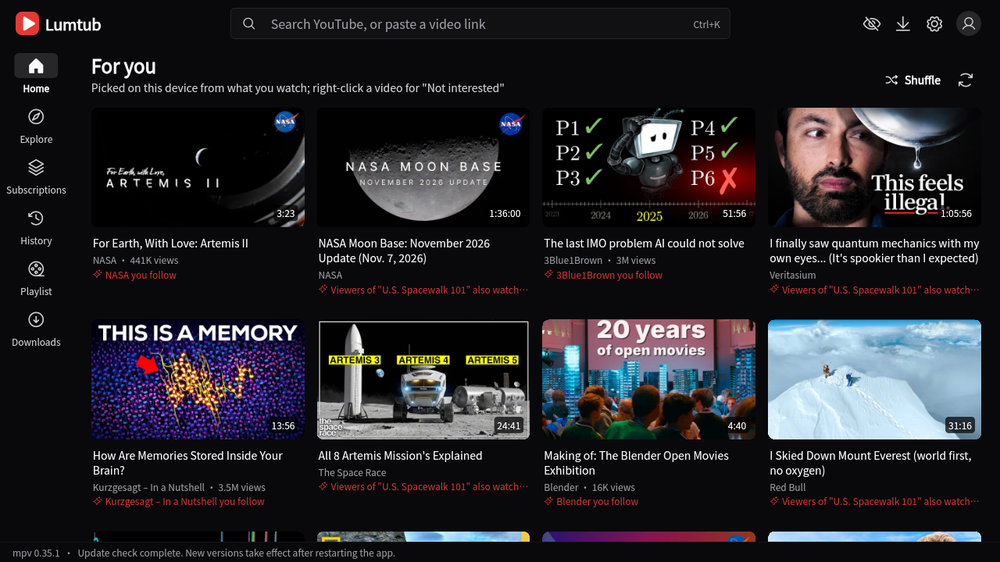
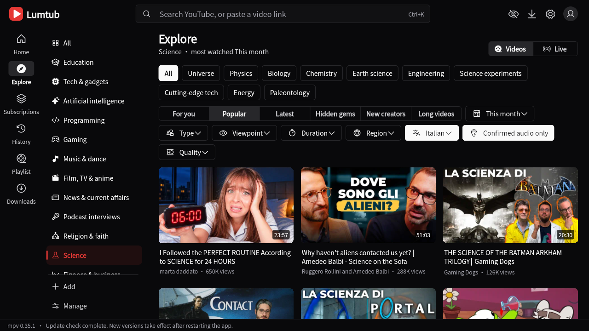
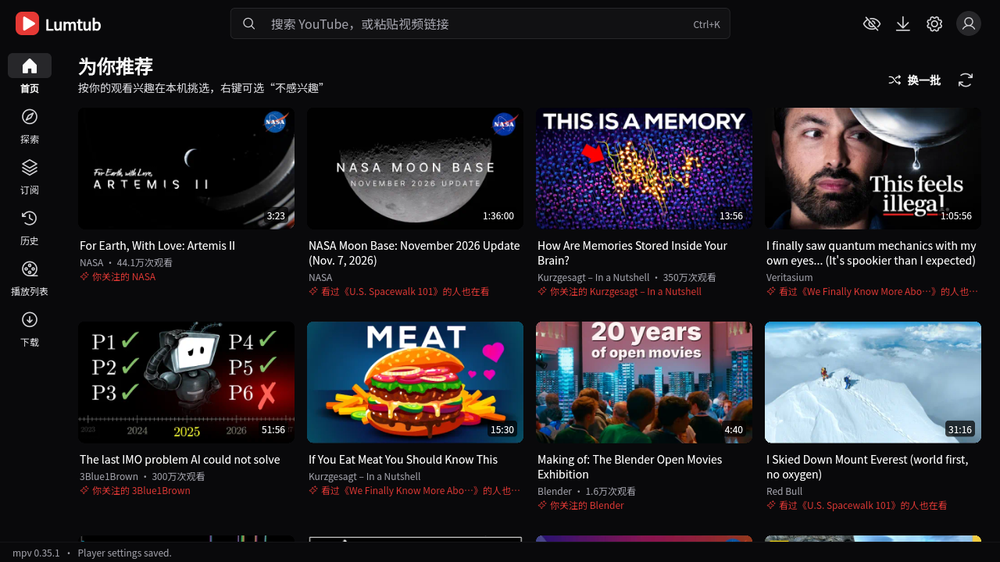

<div align="center">

# ▶ Lumtub — Watch YouTube your way.

**A desktop YouTube client with mpv playback, on-device recommendations you can understand and control, bilingual subtitles and live chat as danmaku on the video.**<br>
Watch without signing in; connect your account only when you want to interact.<br>
For **Windows, Linux and macOS**.

**English** · [简体中文](README.zh-Hans.md)

[](https://github.com/0x696c757a696f/lumtub/releases/latest)
[](https://github.com/sponsors/0x696c757a696f)

[](https://github.com/0x696c757a696f/lumtub/actions/workflows/build.yml)


[](LICENSE)
[](https://hosted.weblate.org/engage/lumtub/)


https://github.com/user-attachments/assets/4ec072a1-6496-46b2-bcba-9b29df811646

[What's different](#what-makes-lumtub-different) · [Features](#features) · [Get it](#get-it) · [Privacy](#privacy-what-stays-local-and-what-doesnt) · [FAQ](#faq) · [Support](#support-lumtub)

</div>

---

## What makes Lumtub different

- **Recommendations you can read and steer.** The For you feed is computed on your computer from your own history. Every card says why it is there, and "Not interested" removes that reason instead of being ignored.
- **mpv playback that checks your hardware.** Videos play through mpv and libmpv, not a web page. Lumtub tests which codecs your GPU really decodes and prefers those formats, to avoid software decoding where hardware decoding is available. The Stats overlay shows what is actually in use. Real CPU, memory and battery use depend on your hardware, the video format and the features you turn on.
- **Watch in any language.** The original audio track plays first. Show two subtitles at once (original and your language), translate with sentence context, and generate subtitles for videos that have none. Titles, descriptions, comments and chat can be translated too. Translation, speech-to-text and summaries are optional and may use a third-party service or your own API key.
- **Live chat on the video.** Chat and chat replays can fly across the picture as danmaku, Bilibili style, or stay in a side panel that holds still while you read.
- **No account to watch.** Search, playback, subscriptions and recommendations work signed out. Sign in only for likes, comments, playlists, members-only videos and other interaction.

Lumtub is free and open source, with no ads, no accounts of its own and no telemetry.

## Features

<table>
<tr>
<td align="center"><br><b>Windows</b></td>
<td align="center"><br><b>macOS</b></td>
<td align="center"><br><b>Linux</b></td>
</tr>
<tr>
<td align="center"><br>Every recommendation says why</td>
<td align="center"><br>Explore by the language actually spoken</td>
<td align="center"><br>72 interface languages</td>
</tr>
<tr>
<td align="center"><br>Search that finds channels and playlists too</td>
<td align="center"><br>Palettes, warm light, compact and low-resource modes</td>
<td align="center"><br>Ten palettes, light and dark</td>
</tr>
</table>

### 🧠 Recommendations and discovery
- **"For you" feed computed locally**, mixing long-term interests, recent ones, exploration and what's popular, with the reason shown on each video.
- **Explore by category**, Bilibili style, sorted by For you, Popular, Latest, Hidden gems, New creators or Long videos. Filter by spoken language (checked from audio and captions), region, quality, length and type, and add your own zones.
- **Channel pages** with videos, Shorts, live, playlists, podcasts and community posts, plus search inside the channel.
- **Subscription groups**, playlists with total and remaining length, watch later and a play queue.
- **Focus mode** hides the home feed, comments and related videos. **Watch statistics** stay on your computer.

### 🎬 Player
- Hardware decoding matched to your GPU; live streams at their best quality, starting at the live edge.
- Theater mode, mini player, borderless picture-in-picture, lights off, A-B loop, storyboard previews and the "most replayed" heatmap.
- Speed and volume remembered per channel; background playback with media keys and a tray icon.
- **Cast** to Chromecast and DLNA TVs, and to AirPlay receivers (preview).
- **Diagnostics:** a network check of the proxy, exit addresses and each kind of request, and a built-in playback test of H.264, VP9 and AV1 on your computer (processor, memory, dropped frames).
- **Downloads:** pick any format YouTube serves, joined without re-encoding, and play it offline in Lumtub.

### 💬 Subtitles and translation
- **Bilingual subtitles** with styles you can tune live, and one-click translation of chapter names.
- **AI translation** through machine translation services or any OpenAI-compatible model you choose.
- **Speech-to-text subtitles** (Groq, OpenAI or your own endpoint) and **AI summaries** of a video from its subtitles. These need a service or API key that you provide, and some providers charge.

### 🔴 Live
- Danmaku for live chat and replays, or a chat that keeps up: newest at the bottom, translate any message, write in chat after signing in.
- Live markers on your subscriptions.
- Super Chat and channel memberships open YouTube's payment pages in your browser.

### 🔐 Accounts only if you want them
- Google, TV-code or browser sign-in for subscriptions, playlists, likes, comments, community posts, polls and **members-only videos** you have access to.
- Credentials are encrypted on your computer, protected by TPM or Windows Hello on Windows and the keyring on Linux and macOS.

### Also built in
These are also found in other YouTube clients, and all are opt-in here:
- **SponsorBlock**, **DeArrow** titles and thumbnails, **Return YouTube Dislike**, hide all Shorts, and an AI filter that hides videos labelled as AI and channels on community AI-slop lists.
- Proxy support (system, HTTP or SOCKS5), optional encrypted DNS, and Piped or Invidious servers as a fallback.
- **72 interface languages**, right to left included, following your system language. Improve them on [Weblate](https://hosted.weblate.org/engage/lumtub/).
- Ten palettes, light and dark, plus an optional warm light, fonts and card sizes.
- Block any channel, or just stop it being recommended.
- Signed automatic updates for the app, yt-dlp and libmpv, with rollback if a new component breaks.

## Get it

<div align="center">

**[⬇ Download the latest release](https://github.com/0x696c757a696f/lumtub/releases/latest)**

</div>

| Package | For |
|---|---|
| `windows-x64-v3` | Most PCs from 2015 on (AVX2) — **pick this if unsure** |
| `windows-x64` | Older x64 CPUs |
| `windows-arm64` | Windows on ARM laptops |
| `linux-x64` AppImage | 64-bit PCs with glibc 2.35 or newer (Ubuntu 22.04, Debian 12, Fedora 36 and later) |
| `linux-arm64` AppImage | ARM64 Linux, such as a Raspberry Pi 5 |
| `macos-arm64` DMG | Macs with Apple silicon (M1 and later) |
| `macos-x64` DMG | Intel Macs |

File names follow `Lumtub_<version>_<platform>`, for example `Lumtub_0.2.29-abc1234_windows-x64-v3-setup.exe`.<br>
**Windows:** use the installer, or unzip the portable version and run `lumtub.exe`. No administrator rights needed.<br>
**Linux:** make the AppImage executable (`chmod +x Lumtub_*.AppImage`) and run it. It updates itself in place.<br>
The first start downloads yt-dlp and Deno from GitHub; after that Lumtub keeps itself up to date.

**macOS:** open the DMG and drag Lumtub into Applications. Lumtub is not notarized by Apple yet, so macOS stops it the first time it opens. Either run this once in Terminal:

```sh
xattr -dr com.apple.quarantine /Applications/Lumtub.app
```

or open it, click **Done**, and choose **Open Anyway** next to Lumtub in **System Settings › Privacy & Security**. Updates after that open normally.


## Privacy: what stays local and what doesn't

Stays on your computer: your watch history, statistics, "Not interested" choices and the recommendation model itself. Recommendations are computed locally. Lumtub never reads your browser's cookies or profiles. The optional browser sign-in opens a separate, temporary window, keeps only YouTube's cookies, encrypts them on your computer and deletes everything else. Syncing your watch history to YouTube is off unless you turn it on.

Leaves your computer, because the feature needs it:
- **YouTube** receives the requests needed to search, load and play videos, and your account actions when signed in. Your search terms go to YouTube like any search.
- **A Piped or Invidious server** sees which video you watch, only if you pick one or YouTube refuses and Lumtub falls back to it.
- **Translation, speech-to-text and AI summaries** send the text or audio involved to the service you configure. All are optional and off until you set them up.
- **SponsorBlock, DeArrow and Return YouTube Dislike** contact their own servers when enabled, using a short hash prefix of the video id where the service supports it.
- **Updates** download from GitHub.

Everything is open source under the GPL, so none of this has to be taken on trust.

## FAQ

**Is it free?** Yes, and it stays free. No ads, no paid tier, no data sold. It's funded by [sponsors](#support-lumtub).

**Will it break when YouTube changes something?** Sometimes, briefly. Lumtub updates yt-dlp on its own, and fixes usually arrive within days.

**Do I need a Google account?** No. Everything except account features (likes, comments, syncing) works signed out.

**Is everything free?** Lumtub is. Some optional AI features (translation, speech-to-text, summaries) use third-party services or your own API keys, and those providers may charge.

**Where is my data?** On Windows in `%LOCALAPPDATA%\Lumtub`, or the `userdata` folder next to `lumtub.exe` for the portable version. On Linux in `~/.local/share/lumtub`, on macOS in `~/Library/Application Support/Lumtub`. Settings can be exported and imported.

**Which Linux systems does it run on?** Any distribution with glibc 2.35 or newer: Ubuntu 22.04, Debian 12, Fedora 36 and later. Ubuntu 20.04 and older, and musl systems such as Alpine, are not supported. On NixOS start it with `appimage-run`.

**Why is there no tray icon on GNOME?** GNOME shows tray icons only with the AppIndicator extension. Ubuntu has it built in; on Fedora and other plain GNOME installs, add [AppIndicator and KStatusNotifierItem Support](https://extensions.gnome.org/extension/615/appindicator-support/). Without it, closing or minimizing to the tray minimizes the window normally instead.

**Why does Linux forget my sign-in?** Lumtub keeps it encrypted in the system keyring (GNOME Keyring or KWallet). A desktop without one, such as a bare window manager, needs `gnome-keyring` or `kwallet` installed and running.

**Was this called YTPlus?** Yes, until October 2026. Updating keeps your settings, library and sign-in.

## Support Lumtub

<div align="center">

**Lumtub is built by one developer, in the open, with no ads and no tracking.**<br>
Sponsors pay for the time to build it.

<a href="https://github.com/sponsors/0x696c757a696f"></a>

**Monthly sponsors** decide what comes next: Android, a code-signing certificate so Windows stops warning on install, and Apple notarization.<br>
One-time gifts of any amount are just as welcome. The same page is in the app under Settings › About › Support development.

</div>

Other ways to give, crypto included, are in [SPONSORING.md](SPONSORING.md).

Can't give money? ⭐ Star the repository, tell a friend, [report a bug or suggest an idea](https://github.com/0x696c757a696f/lumtub/issues), or [translate Lumtub](https://hosted.weblate.org/engage/lumtub/). It all helps.

---

<details>
<summary><b>For developers: building, Google OAuth client, translations</b></summary>

### Building

Every push and pull request to `main` builds on GitHub Actions (`.github/workflows/build.yml`): a verified libmpv per CPU, the Rust core in `native/lumtub_core` (fat LTO), `flutter analyze`, the unit tests, a portable ZIP and an Inno Setup installer for x64, x64-v3 and arm64. Releases are made by the Create release workflow and carry signed packages.

Locally you need Flutter 3.47, Visual Studio with the C++ desktop workload, and Rust:

```powershell
flutter pub get
cargo build --release --manifest-path native/lumtub_core/Cargo.toml
flutter test
flutter build windows --release
```

### Your own Google OAuth client

1. In Google Cloud Console, create an OAuth client of type "Desktop app" and enable YouTube Data API v3.
2. Enter its client ID and secret under Settings › YouTube account, or build them in with the repository secrets `YTPLUS_GOOGLE_CLIENT_ID` and `YTPLUS_GOOGLE_CLIENT_SECRET`.
3. An unreviewed client makes Google warn that the app is unverified; continue past it.

### Translations

Source strings are English wrapped in `tr('…')`; translations, simplified Chinese included, live in `assets/l10n` keyed by that English text and are managed on [Weblate](https://hosted.weblate.org/engage/lumtub/). See [TRANSLATING.md](TRANSLATING.md).

</details>

## License and attribution

Lumtub is licensed under the GNU General Public License, version 3 or later (`GPL-3.0-or-later`).

The settings tiles in `lib/widgets/pilinara_settings_tiles.dart` are adapted from [PiliNara](https://github.com/Starfallan/PiliNara), copyright its contributors, and remain under GPL-3.0-or-later; parts of Lumtub's interface follow PiliNara's design. `vendor/pilinara-settings/` and `vendor/pilinara-player/` are unmodified PiliNara snapshots kept for reference and not built. `vendor/media_kit_video/` is a modified copy of media_kit_video (see its `LUMTUB.md`).

Built on [media_kit](https://github.com/media-kit/media-kit), [mpv](https://mpv.io), [yt-dlp](https://github.com/yt-dlp/yt-dlp) and [FFmpeg](https://ffmpeg.org). AI channel lists come from [KillSlop](https://killslop.app) (CC BY-SA 4.0) and [AiSList](https://github.com/Override92/AiSList) (CC BY-NC 4.0), downloaded at runtime and not shipped with Lumtub. The bundled Noto Sans SC font is under the SIL Open Font License 1.1 (`assets/fonts/OFL.txt`); the Phosphor icon fonts are under the MIT License (`assets/fonts/phosphor/LICENSE`). Other packages and components keep their own licenses; see `NOTICE` before redistributing.

Lumtub is not affiliated with or endorsed by YouTube or Google.
