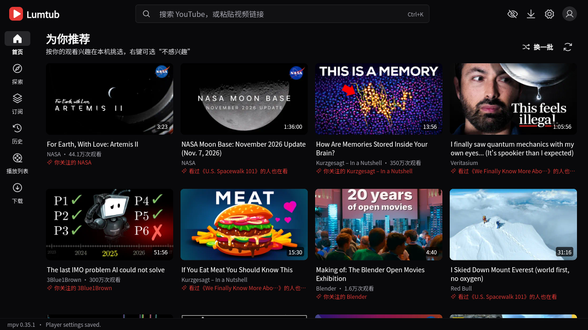
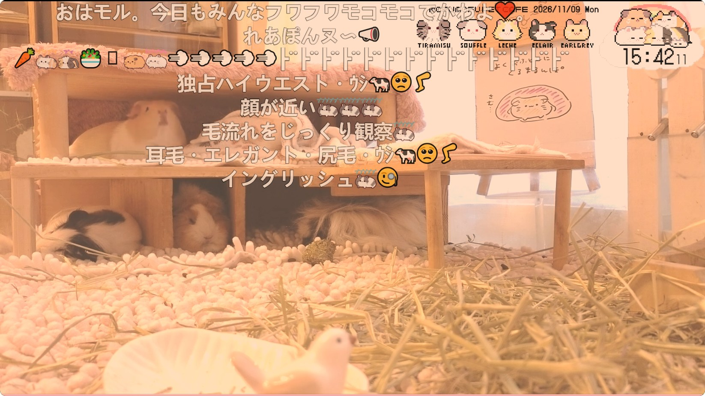
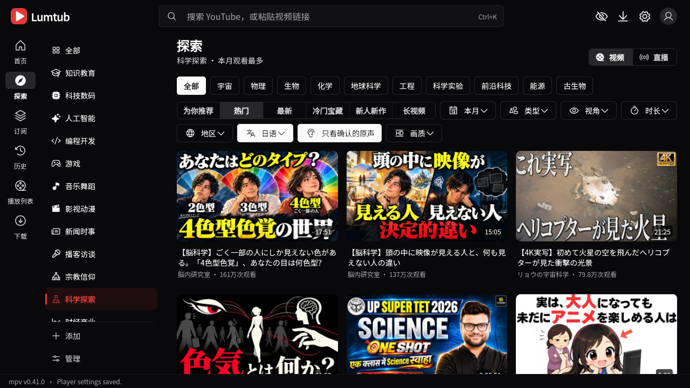
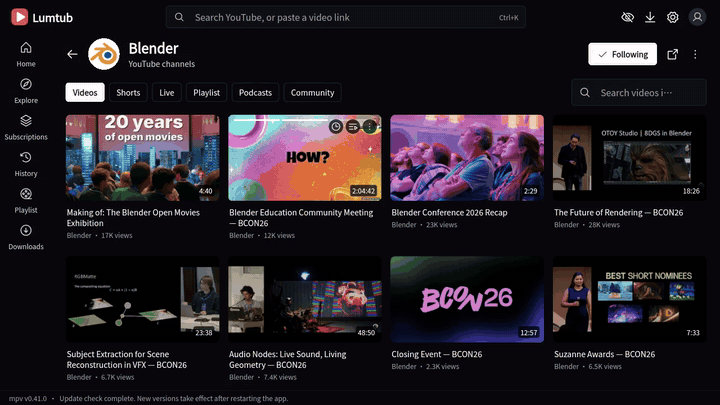
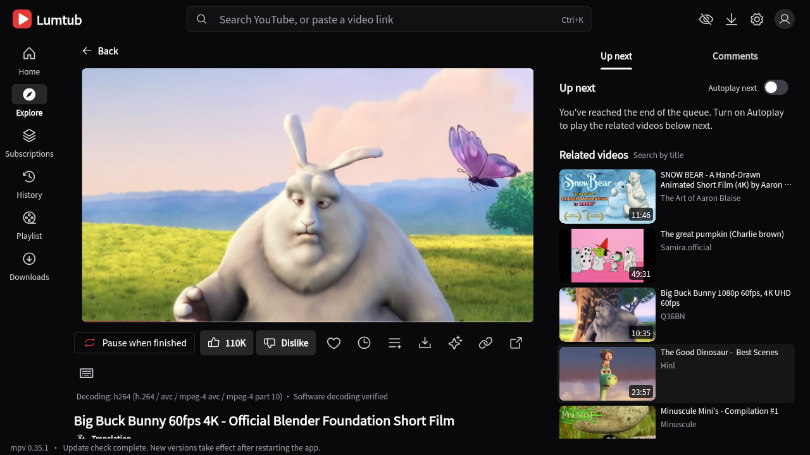
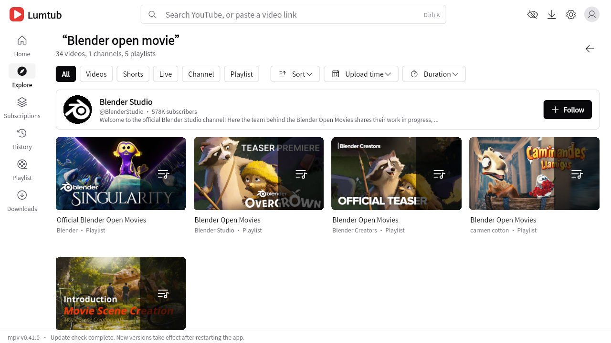
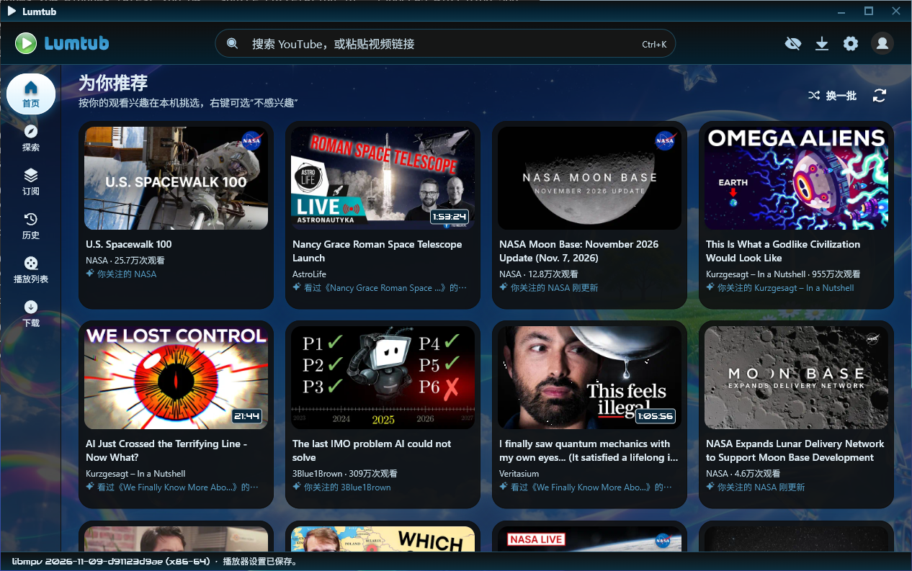
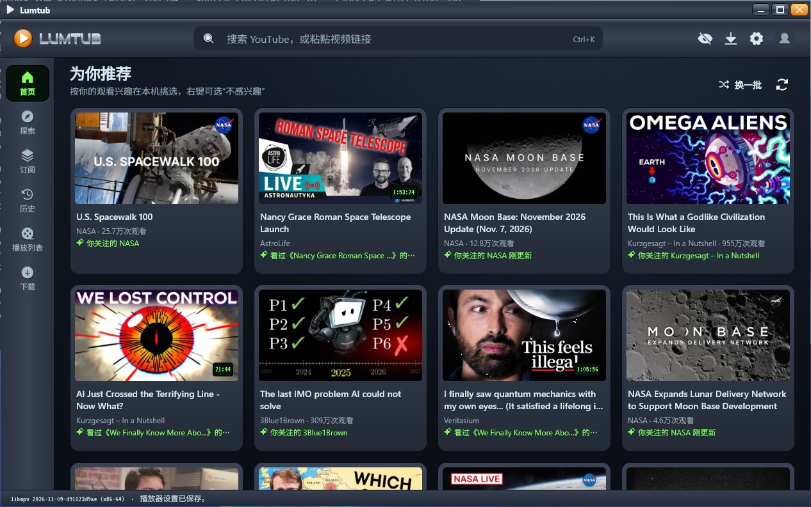

<div align="center">

# ▶ Lumtub：按你的方式看 YouTube

**YouTube 客户端：mpv 播放，本机计算、看得懂也调得动的推荐，双语字幕，直播聊天变成弹幕。**<br>
不登录也能看；只有想点赞、评论时才需要连接账号。<br>
支持 **Windows、Linux、macOS 和 Android**（手机、平板和电视）。

[English](README.md) · **简体中文**

[](https://github.com/0x696c757a696f/lumtub/releases/latest)
[](https://github.com/sponsors/0x696c757a696f)

[](https://github.com/0x696c757a696f/lumtub/actions/workflows/build.yml)


[](LICENSE)
[](https://hosted.weblate.org/engage/lumtub/)

[有什么不同](#有什么不同) · [功能](#功能) · [下载](#下载) · [隐私](#隐私哪些留在本机哪些会发出去) · [常见问题](#常见问题) · [支持](#支持-lumtub)

</div>

---

## 有什么不同

- **推荐看得懂、调得动。** “为你推荐”在你自己的电脑上，根据你自己的观看记录计算。每张卡片都写着推荐它的原因，点“不感兴趣”会去掉这个原因，而不是被无视。
- **mpv 播放，先看你的硬件。** 视频由 mpv 和 libmpv 播放，不是网页。Lumtub 会测试你的显卡真正能硬解哪些编码，优先选这些格式，能硬解就不用软解。统计信息里能看到实际用的是什么。实际的处理器、内存和耗电取决于你的硬件、视频格式和打开的功能。
- **用任何语言看。** 优先播放原声音轨。可以同时显示两种字幕（原文和你的语言），结合上下文翻译，还能给没有字幕的视频生成字幕。标题、简介、评论和聊天也能翻译。翻译、语音转字幕和总结都是可选的，可能用到第三方服务或你自己的 API 密钥。
- **直播聊天上屏。** 直播聊天和聊天回放可以像 B 站一样变成弹幕从画面上飞过，也可以放在侧栏里，阅读时不会乱跳。
- **不用账号也能看。** 搜索、播放、订阅和推荐都不需要登录。只有点赞、评论、播放列表、会员专属视频等互动才需要登录。

Lumtub 免费开源，没有广告，没有自己的账号体系，也不收集遥测数据。

## 功能

<table>
<tr>
<td align="center" width="50%"><br><b>每条推荐都写明原因</b></td>
<td align="center" width="50%"><br><b>直播聊天变弹幕</b></td>
</tr>
<tr>
<td align="center" width="50%"><br><b>按视频里真正说的语言探索</b></td>
<td align="center" width="50%"><br><b>十套配色，浅色深色</b></td>
</tr>
<tr>
<td align="center"><br><b>mpv 播放</b></td>
<td align="center"><br><b>搜索也能找到频道和播放列表</b></td>
</tr>
<tr>
<td align="center"><br><b>皮肤：泡泡凝胶</b></td>
<td align="center"><br><b>千禧播放器，带液晶屏</b></td>
</tr>
</table>

### 🧠 推荐与发现
- **本机计算的“为你推荐”**，混合长期兴趣、近期兴趣、探索和热门，每个视频都标明推荐原因。
- **按分区探索**，类似 B 站，可按为你推荐、热门、最新、宝藏、新人和长视频排序。可按视频实际说的语言（从音频和字幕判断）、地区、画质、时长和类型筛选，也能添加自己的分区。
- **频道页**包括视频、Shorts、直播、播放列表、播客和社区帖子，并可在频道内搜索。
- **订阅分组**，播放列表显示总时长和剩余时长，稍后观看和播放队列。
- **专注模式**隐藏首页推荐、评论和相关视频。**观看统计**只留在你的电脑上。

### 🎬 播放器
- 按你的显卡选择硬件解码；直播以最高画质从最新处开始播放。
- 剧场模式、小窗播放、无边框画中画、关灯模式、A-B 循环、进度条预览图和“最常重播”热度曲线。
- 按频道记住播放速度和音量；后台播放，支持媒体键和托盘图标。
- **投屏**到 Chromecast、DLNA 电视，以及 AirPlay 设备（预览版）。
- **下载**：可选 YouTube 提供的任意格式，合并时不重新编码，并可在 Lumtub 里离线播放。
- **诊断**：网络诊断逐项检查代理、出口地址和各类请求；内置播放测试比较 H.264、VP9 和 AV1 在这台电脑上的处理器占用、内存和丢帧。

### 💬 字幕与翻译
- **双语字幕**，样式可边看边调，章节名一键翻译。
- **AI 翻译**，可用机器翻译服务，或你选择的任何兼容 OpenAI 的模型。
- **语音转字幕**（Groq、OpenAI 或你自己的接口）和基于字幕的 **AI 视频总结**。这些需要你自己提供服务或 API 密钥，部分服务商会收费。

### 🔴 直播
- 直播和回放的弹幕，或跟得上的聊天栏：最新消息在底部，任意消息可翻译，登录后可以发言。
- 订阅列表里标出正在直播的频道。
- Super Chat 和加入会员会在浏览器中打开 YouTube 的付款页面。

### 🔐 账号只在你需要时使用
- 支持 Google、电视验证码或浏览器登录，用于订阅、播放列表、点赞、评论、社区帖子、投票，以及你有权观看的**会员专属视频**。
- 登录凭据加密保存在你的电脑上：Windows 用 TPM 或 Windows Hello 保护，Linux 和 macOS 用系统钥匙串。

### 其他内置功能
这些在别的 YouTube 客户端里也有，在这里都需要手动开启：
- **SponsorBlock**、**DeArrow** 标题和缩略图、**Return YouTube Dislike**、隐藏所有 Shorts，以及隐藏标注为 AI 生成的视频和社区 AI 垃圾内容名单上频道的 AI 过滤。
- 代理（系统、HTTP 或 SOCKS5）、可选的加密 DNS，以及作为备用的 Piped 或 Invidious 服务器。
- **72 种界面语言**，包括从右到左的文字，默认跟随系统语言。欢迎在 [Weblate](https://hosted.weblate.org/engage/lumtub/) 上改进翻译。
- **皮肤**：换掉整个界面的样子，内置二十三套，从千禧年的光泽风格、Frutiger Aero 风景到黑白点阵，还可以用皮肤自己的标题栏和菜单栏。人人都能做皮肤：写一个带注释的 `skin.jsonc` 就行，颜色对比度会自动检查。见 [skins/README.md](skins/README.md)。
- 十套配色，浅色深色，可选护眼暖光、字体和卡片大小。
- 屏蔽任意频道，或只是不再推荐它。
- **屏蔽列表**：争议宗教团体和官方宣传媒体，默认不开，自己在设置里打开。列表是 [lists/](lists/) 里公开的文件，每天带签名自动更新，谁都可以建议加入频道或报告误列。见 [lists/README.md](lists/README.md#怎么贡献)。
- 应用、yt-dlp 和 libmpv 都有签名的自动更新，新组件出问题时会自动回退。

## 下载

<div align="center">

**[⬇ 下载最新版本](https://github.com/0x696c757a696f/lumtub/releases/latest)**

</div>

| 安装包 | 适用于 |
|---|---|
| `windows-x64-v3` | 2015 年以后的大多数电脑（支持 AVX2）。**不确定就选这个** |
| `windows-x64` | 较老的 x64 处理器 |
| `windows-arm64` | Windows on ARM 笔记本 |
| `linux-x64` AppImage | glibc 2.35 或更新的 64 位电脑（Ubuntu 22.04、Debian 12、Fedora 36 及以后） |
| `linux-arm64` AppImage | ARM64 Linux，例如树莓派 5 |
| `macos-arm64` DMG | Apple 芯片的 Mac（M1 及以后） |
| `macos-x64` DMG | Intel 芯片的 Mac |
| `android-arm64-v8a` APK | 大多数 Android 手机、平板和电视（Android 7.0 及以上）。**不确定就选这个** |
| `android-armeabi-v7a` APK | 较老的 32 位 Android 设备和不少廉价电视盒子 |
| `android-x86_64` APK | Android 模拟器和 x86 Chromebook |

文件名格式为 `Lumtub_<版本>_<平台>`，例如 `Lumtub_0.2.30-abc1234_windows-x64-v3-setup.exe`。<br>
**Windows**：用安装程序安装，或解压便携版后运行 `lumtub.exe`。不需要管理员权限。<br>
**Linux**：给 AppImage 加上执行权限（`chmod +x Lumtub_*.AppImage`）后运行。它会原地自动更新。如果提示缺少 FUSE，请安装发行版的 `fuse3` 软件包，或用 `--appimage-extract-and-run` 参数启动。<br>
第一次启动时会从 GitHub 下载 yt-dlp 和 Deno，之后 Lumtub 会自己保持更新。<br>
**Android（预览版）**：打开 APK，按提示允许浏览器或文件管理器安装应用。新版本可以在 Lumtub 里直接安装，Android 会请你确认一次。直播和下载也都能用，靠的是应用里自带的 yt-dlp；会员专属视频在 Android 上暂时还不能看。

**macOS**：打开 DMG，把 Lumtub 拖进“应用程序”。Lumtub 还没有经过 Apple 公证，所以第一次打开时会被 macOS 拦下。可以在终端里运行一次：

```sh
xattr -dr com.apple.quarantine /Applications/Lumtub.app
```

或者先打开一次，点“完成”，再到 **系统设置 › 隐私与安全性** 里 Lumtub 旁边点“仍要打开”。之后的更新都能正常打开。

## 隐私：哪些留在本机，哪些会发出去

留在你电脑上的：观看记录、统计、“不感兴趣”的选择，以及推荐模型本身。推荐在本机计算。Lumtub 从不读取浏览器的 Cookie 或配置文件。可选的浏览器登录会打开一个独立的临时窗口，只保留 YouTube 的 Cookie，加密保存在你的电脑上，其余全部删除。观看记录同步到 YouTube 默认关闭，除非你自己打开。

因为功能需要而发出去的：
- **YouTube** 会收到搜索、加载和播放视频所需的请求，登录后还有你的账号操作。你的搜索词和任何搜索一样会发给 YouTube。
- **Piped 或 Invidious 服务器**只有在你选择了它，或 YouTube 拒绝后 Lumtub 改用它时，才会知道你在看哪个视频。
- **翻译、语音转字幕和 AI 总结**会把相关的文字或音频发给你设置的服务。这些都是可选的，设置之前不会启用。
- **SponsorBlock、DeArrow 和 Return YouTube Dislike** 开启后会连接它们自己的服务器，服务支持的话只发送视频 ID 的一小段哈希前缀。
- **更新**从 GitHub 下载。

所有代码都以 GPL 开源，这些都不需要只靠信任。

## 常见问题

**免费吗？** 免费，并且会一直免费。没有广告，没有付费版，不卖数据。开发靠[赞助](#支持-lumtub)。

**YouTube 改了东西会不会用不了？** 有时会短暂失效。Lumtub 会自动更新 yt-dlp，通常几天内就会修好。

**需要 Google 账号吗？** 不需要。除了点赞、评论、同步这些账号功能，其他都能在不登录时使用。

**所有功能都免费吗？** Lumtub 本身免费。部分可选的 AI 功能（翻译、语音转字幕、总结）使用第三方服务或你自己的 API 密钥，这些服务商可能收费。

**数据存在哪里？** Windows 在 `%LOCALAPPDATA%\Lumtub`，便携版在 `lumtub.exe` 旁边的 `userdata` 文件夹。Linux 在 `~/.local/share/lumtub`，macOS 在 `~/Library/Application Support/Lumtub`。设置可以导出和导入。

**支持哪些 Linux？** glibc 2.35 或更新的发行版：Ubuntu 22.04、Debian 12、Fedora 36 及以后。不支持 Ubuntu 20.04 及更早版本，也不支持 Alpine 等 musl 系统。NixOS 上请用 `appimage-run` 启动。

**为什么 GNOME 上没有托盘图标？** GNOME 只有装了 AppIndicator 扩展才显示托盘图标。Ubuntu 已经自带；Fedora 等原版 GNOME 请安装 [AppIndicator and KStatusNotifierItem Support](https://extensions.gnome.org/extension/615/appindicator-support/)。没有它时，关闭或最小化到托盘会改为普通的最小化。

**为什么 Linux 上会忘记登录？** Lumtub 把登录信息加密存在系统钥匙串（GNOME Keyring 或 KWallet）里。没有钥匙串的桌面，例如只装了窗口管理器的系统，需要安装并运行 `gnome-keyring` 或 `kwallet`。

**它以前叫 YTPlus 吗？** 是的，2026 年 10 月之前叫 YTPlus。更新后设置、媒体库和登录都会保留。

## 支持 Lumtub

<div align="center">

**Lumtub 由一位开发者公开开发，没有广告，也不追踪你。**<br>
赞助支付的是开发它的时间。

<a href="https://github.com/sponsors/0x696c757a696f"></a>

**每月赞助者**决定接下来做什么：让 Windows 安装时不再警告的代码签名证书，以及 Apple 公证。<br>
任何金额的一次性赞助同样欢迎。应用里的 设置 › 关于 › 支持开发 也是同一个页面。

</div>

其他赞助方式（包括加密货币）见 [SPONSORING.md](SPONSORING.md)。

不方便出钱？给仓库点个 ⭐，推荐给朋友，[报告问题或提建议](https://github.com/0x696c757a696f/lumtub/issues)，[给屏蔽列表推荐频道](lists/README.md#怎么贡献)，或者[帮忙翻译 Lumtub](https://hosted.weblate.org/engage/lumtub/)，都很有帮助。

---

开发者说明（构建、Google OAuth 客户端、翻译）见[英文 README](README.md) 末尾的 “For developers” 部分。

## 许可与致谢

Lumtub 以 GNU 通用公共许可证第 3 版或更新版本（`GPL-3.0-or-later`）发布。

`lib/widgets/pilinara_settings_tiles.dart` 中的设置项改编自 [PiliNara](https://github.com/Starfallan/PiliNara)，版权归其贡献者所有，仍以 GPL-3.0-or-later 发布；Lumtub 的部分界面参考了 PiliNara 的设计。`vendor/pilinara-settings/` 是未经修改的 PiliNara 快照，仅供参考，不参与构建；PiliNara 的其余部分见上面链接的仓库。`vendor/media_kit_video/` 是修改过的 media_kit_video（见其中的 `LUMTUB.md`）。

基于 [media_kit](https://github.com/media-kit/media-kit)、[mpv](https://mpv.io)、[yt-dlp](https://github.com/yt-dlp/yt-dlp) 和 [FFmpeg](https://ffmpeg.org) 构建。AI 频道名单来自 [KillSlop](https://killslop.app)（CC BY-SA 4.0）和 [AiSList](https://github.com/Override92/AiSList)（CC BY-NC 4.0），在运行时下载，不随 Lumtub 分发。内置的 Noto Sans SC 字体采用 SIL Open Font License 1.1（`assets/fonts/OFL.txt`）；Phosphor 图标字体采用 MIT 许可证（`assets/fonts/phosphor/LICENSE`）。其他软件包和组件保留各自的许可证；再分发前请参阅 `NOTICE`。

Lumtub 与 YouTube 或 Google 无关，也未获得其认可。
