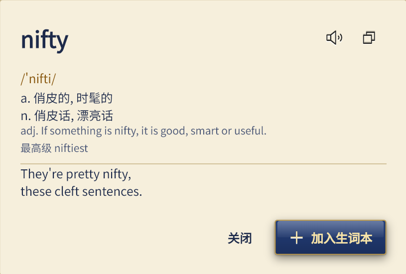
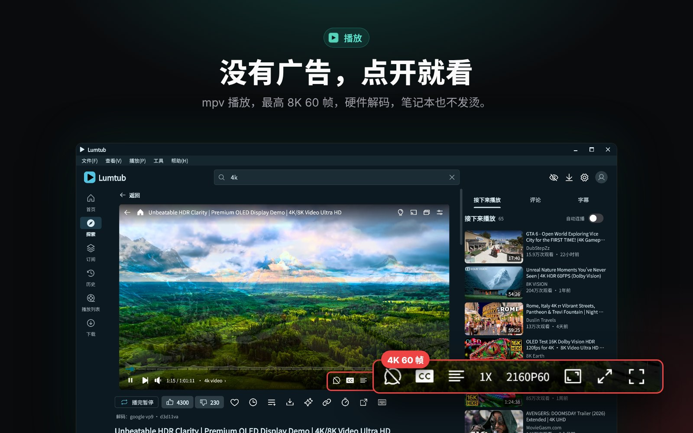
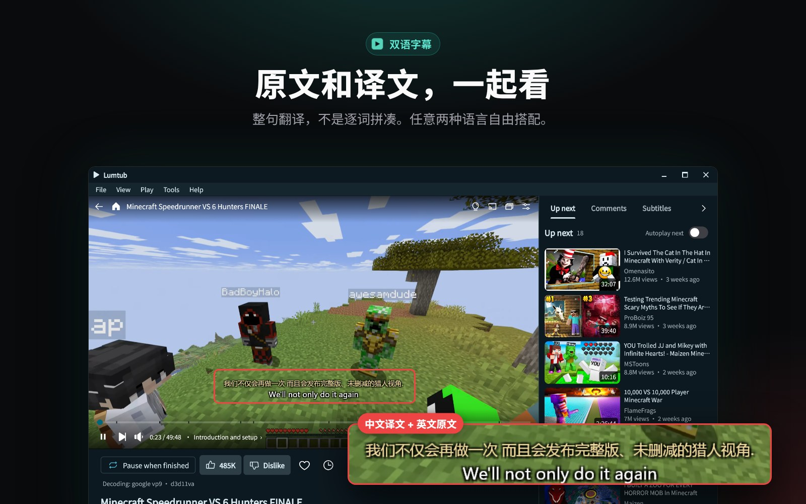
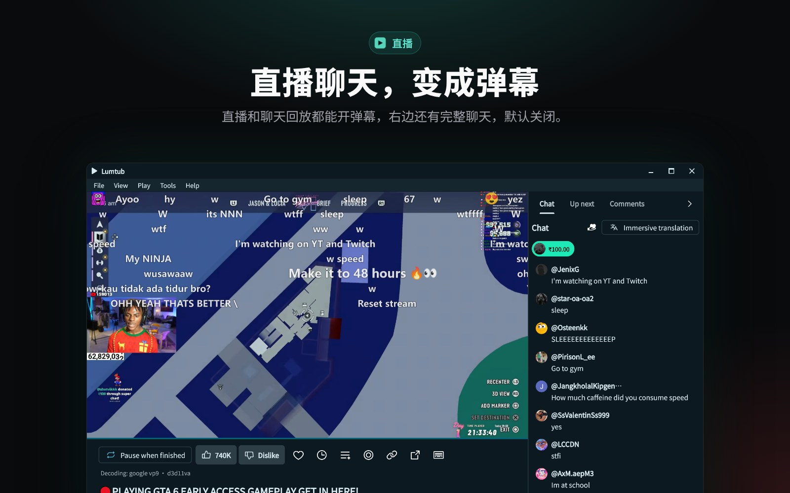
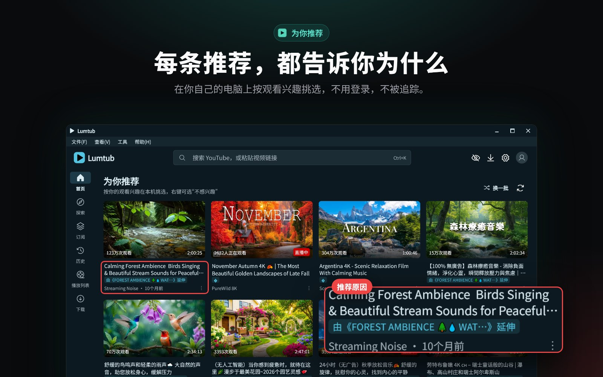
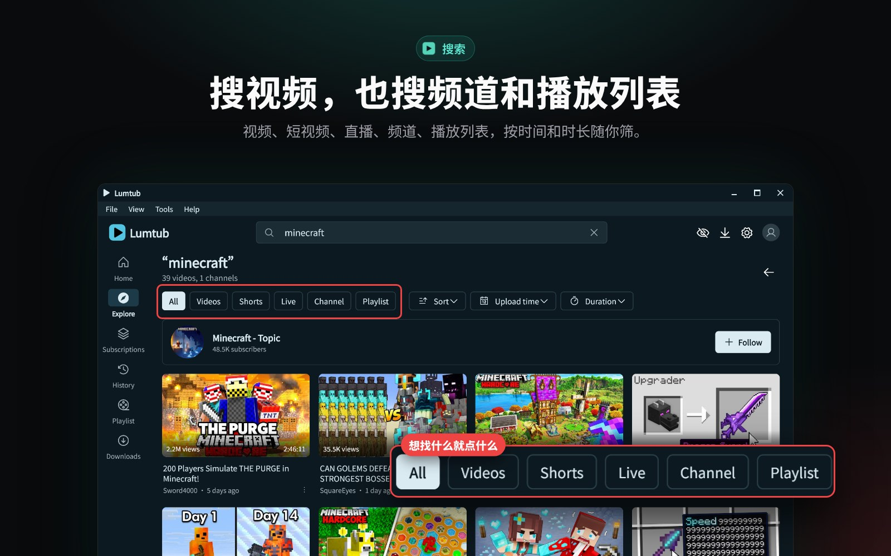
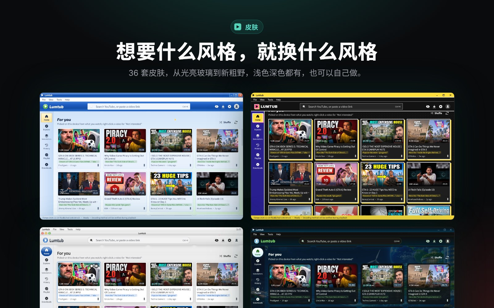
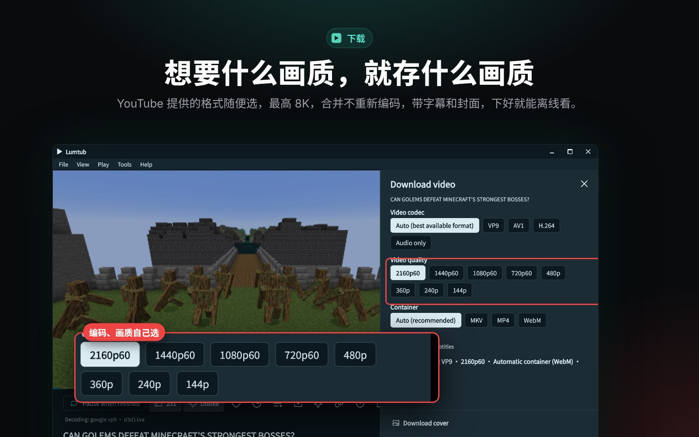
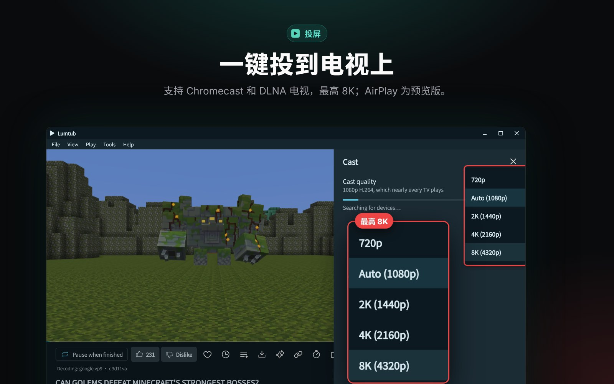

<div align="center">


# Lumtub

**按你的方式看 YouTube。**<br>
没有广告，mpv 播放，推荐写明原因，双语字幕，直播聊天变弹幕。<br>
不用登录也能看。

[English](README.md) · **简体中文**

[](https://github.com/0x696c757a696f/lumtub/releases/latest)
[](https://github.com/0x696c757a696f/lumtub/releases)
[](https://github.com/0x696c757a696f/lumtub/actions/workflows/build.yml)
[](LICENSE)
[](https://hosted.weblate.org/engage/lumtub/)
[](https://github.com/0x696c757a696f/lumtub/stargazers)
<a href="#支持-lumtub"></a>

#### 下载

<a href="https://github.com/0x696c757a696f/lumtub/releases/latest"></a>
<a href="https://github.com/0x696c757a696f/lumtub/releases/latest"></a>
<a href="https://github.com/0x696c757a696f/lumtub/releases/latest"></a>
<a href="https://github.com/0x696c757a696f/lumtub/releases/latest"></a>
<a href="https://github.com/0x696c757a696f/lumtub/releases/latest"></a>

<sub>免费开源，不收集遥测数据。不知道选哪个文件？看<a href="#下载">下载</a>一节。iPhone 和 iPad 版为预览版。</sub>

⭐ **觉得好用？在 GitHub 右上角点个 Star 吧。** 不花一分钱，却是新用户发现 Lumtub 的主要途径。

[学外语](#-用真实视频学外语) · [截图](#截图) · [功能](#功能) · [下载](#下载) · [数据来源](#数据来源) · [隐私](#隐私哪些留在本机哪些会发出去) · [常见问题](#常见问题) · [支持](#支持-lumtub)

</div>
---

## 有什么不同

- **推荐看得懂、调得动。** “为你推荐”在你自己的电脑上，根据你自己的观看记录计算。每张卡片都写着推荐它的原因，点“不感兴趣”会去掉这个原因，而不是被无视。
- **mpv 播放，先看你的硬件。** 视频由 mpv 和 libmpv 播放，不是网页。Lumtub 会测试你的显卡真正能硬解哪些编码，优先选这些格式，能硬解就不用软解。统计信息里能看到实际用的是什么。实际的处理器、内存和耗电取决于你的硬件、视频格式和打开的功能。
- **用任何语言看。** 优先播放原声音轨。可以同时显示两种字幕（原文和你的语言），结合上下文翻译，还能给没有字幕的视频生成字幕。标题、简介、评论和聊天也能翻译。翻译、语音转字幕和总结都是可选的，可能用到第三方服务或你自己的 API 密钥。
- **直播聊天上屏。** 直播聊天和聊天回放可以像 B 站一样变成弹幕从画面上飞过，也可以放在侧栏里，阅读时不会乱跳。
- **不用账号也能看。** 搜索、播放、订阅和推荐都不需要登录。只有点赞、评论、播放列表、会员专属视频等互动才需要登录。

Lumtub 免费开源，没有广告，没有自己的账号体系，也不收集遥测数据。

## 🆕 用真实视频学外语

**点字幕里的词就能查，中文标拼音、日语标假名，生词连同原句和原声存进生词本，一键进 Anki。离线词典，一次买断。**

<p align="center">


</p>
<p align="center"><sub>测试版真实截图。</sub></p>

**学习包**（测试版，Windows、macOS、Linux）：

- **点词就查**：词典下载一次，之后查词不用联网。中文、英语、日语、韩语；西班牙语、法语、德语、意大利语、俄语为测试版。
- **字幕上方注音**：中文拼音、日语假名、韩语罗马音。
- **比你水平难的词自动标出来**，只在不认识的词上停下。
- **生词本**：记下原句、原声和视频里的时间点，点一下再听一遍。
- **一键送进 Anki**，也可以导出 CSV。

**免费试用**：前 30 次查词所有功能全部开放，不用注册。之后不买的话，每天能查 3 个词。[安装说明和退款](https://0x696c757a696f.github.io/lumtub/learn/zh/)。<br>
**早鸟价**：¥99，到 12 月 3 日；之后 ¥188。一次付款，不订阅，在[爱发电](https://afdian.com/a/linmuqingfeng)购买。一份授权 2 台设备，软件大约每 30 天联网确认一次授权。

**所有人免费**，在字幕菜单 › **学外语** 里：

- **每句说完暂停**（Q）：一句字幕结束就停下，听懂了再往下看。
- **模糊翻译**（V）：第二行字幕先模糊，鼠标移上去、点一下或按键才显示。先猜，再对答案。
- **重听、单句循环、上一句和下一句**（R、Shift+R、A、D）：都按字幕一句一句跳，跳完直接播放。
- **跟读**（E）：录下自己说这句话，然后原声和你的录音先后播放，方便对比。录音只留在你的设备上。
- **字幕列表导出 CSV**：每句原文带翻译，可以导入 Anki 或表格。

配合双语字幕和「按视频实际语言找视频」，任何视频都能拿来练听力。触屏和电视遥控器也有对应的按钮。

## 截图

<table>
<tr>
<td align="center" width="50%"></td>
<td align="center" width="50%"></td>
</tr>
<tr>
<td align="center" width="50%"></td>
<td align="center" width="50%"></td>
</tr>
<tr>
<td align="center" width="50%"></td>
<td align="center" width="50%"></td>
</tr>
<tr>
<td align="center" width="50%"></td>
<td align="center" width="50%"></td>
</tr>
</table>

## 功能

### 🧠 推荐与发现
- **本机计算的“为你推荐”**，混合长期兴趣、近期兴趣、探索和热门，每个视频都标明推荐原因。
- **按分区探索**，类似 B 站，可按为你推荐、热门、最新、宝藏、新人和长视频排序。可按视频实际说的语言（从音频和字幕判断）、地区、画质、时长和类型筛选，也能添加自己的分区。
- **频道页**包括视频、Shorts、直播、播放列表、播客和社区帖子，并可在频道内搜索。
- **订阅分组**，播放列表显示总时长和剩余时长，稍后观看和播放队列。
- 🆕 **订阅随时搬家**：不用登录就能导入 NewPipe、FreeTube、Google Takeout 或 OPML 的订阅，也能再导出；还可以连同设置把整个媒体库一起备份。
- **专注模式**隐藏首页推荐、评论和相关视频。**观看统计**只留在你的电脑上。

### 🎬 播放器
- 按你的显卡选择硬件解码；直播以最高画质从最新处开始播放。
- 剧场模式、小窗播放、无边框画中画、关灯模式、A-B 循环、进度条预览图和“最常重播”热度曲线。画中画和应用内小窗里的字幕可以单独关掉。
- 按频道记住播放速度和音量；后台播放，支持媒体键和托盘图标。
- **音量均衡**（默认关闭）：根据 YouTube 测得的响度，拉平不同视频之间和同一视频内的音量差。
- 视频上的鼠标滚轮可以按需设为调音量或亮度（设置 › 控制与快捷键），默认只滚动页面。Ctrl + 滚轮调倍速。
- **投屏**到 Chromecast、DLNA 电视，以及 AirPlay 设备（预览版）。
- 🆕 **下载**：可选 YouTube 提供的任意格式，合并时不重新编码，并可在 Lumtub 里离线播放。
- **诊断**：网络诊断逐项检查代理、出口地址和各类请求；内置播放测试比较 H.264、VP9 和 AV1 在这台电脑上的处理器占用、内存和丢帧。

### 💬 字幕与翻译
- **双语字幕**，样式可边看边调，章节名一键翻译。
- **AI 翻译**，可用机器翻译服务（🆕 包括免费、不用密钥的 MyMemory），或你选择的任何兼容 OpenAI 的模型。
- **语音转字幕**（Groq、OpenAI 或你自己的接口）和基于字幕的 **AI 视频总结**。这些需要你自己提供服务或 API 密钥，部分服务商会收费。

### 🔴 直播
- 直播和回放的弹幕，或跟得上的聊天栏：最新消息在底部，任意消息可翻译，登录后可以发言。
- 订阅列表里标出正在直播的频道。
- Super Chat 和加入会员会在浏览器中打开 YouTube 的付款页面。

### 🔐 账号只在你需要时使用
- 🆕 **一次登录全搞定**：在浏览器窗口里登录一次，首页推荐、观看记录、稍后观看、播放列表、点赞、评论、订阅、社区帖子、投票，以及你有权观看的**会员专属视频**就都能用。用自己的 Google 客户端登录仍可选。
- 登录凭据加密保存在你的电脑上：Windows 用 TPM 或 Windows Hello 保护，Linux 和 macOS 用系统钥匙串。
- 🆕 **抗量子加密**：Lumtub 自己发起的 HTTPS 连接（YouTube 页面和数据、视频中转、加密 DNS、更新）在服务器支持时使用 X25519MLKEM768 混合密钥交换，YouTube 已经支持。设置 › 网络里能看到每个网站商定的方式，也可以改成必须或关闭。播放器和 yt-dlp 自己的连接不在其中。

### 其他内置功能
这些在别的 YouTube 客户端里也有，在这里都需要手动开启：
- **SponsorBlock**、**DeArrow** 标题和缩略图、**Return YouTube Dislike**、隐藏所有 Shorts，以及隐藏标注为 AI 生成的视频和社区 AI 垃圾内容名单上频道的 AI 过滤。
- 代理（系统、HTTP 或 SOCKS5）、可选的加密 DNS，以及作为备用的 Piped 或 Invidious 服务器。🆕 YouTube 弹出机器人验证时，Lumtub 会自己在 IPv4 和 IPv6 之间切换。
- 🆕 电脑版用内置的 QuickJS 直接解 YouTube 的 JavaScript 验证，Deno 作为备用。
- **82 种界面语言**，包括从右到左的文字，默认跟随系统语言。欢迎在 [Weblate](https://hosted.weblate.org/engage/lumtub/) 上改进翻译。
- **皮肤**：换掉整个界面的样子，内置三十六套，从千禧年的光泽风格、Frutiger Aero 风景到黑白点阵、软陶和新粗野主义，还可以用皮肤自己的标题栏和菜单栏。人人都能做皮肤：写一个带注释的 `skin.jsonc` 就行，颜色对比度会自动检查。见 [skins/README.md](skins/README.md)。
- 十套配色，浅色深色，可选护眼暖光、字体和卡片大小。
- 🆕 **窗口透明**：像玻璃一样透出桌面，任何皮肤都能用，可加模糊。
- 屏蔽任意频道，或只是不再推荐它。
- **屏蔽列表**：争议宗教团体和官方宣传媒体，默认不开，自己在设置里打开。列表是 [lists/](lists/) 里公开的文件，每天带签名自动更新，谁都可以建议加入频道或报告误列。见 [lists/README.md](lists/README.md#怎么贡献)。
- 应用、yt-dlp 和 libmpv 都有签名的自动更新，新组件出问题时会自动回退。

## 下载

<div align="center">

**[⬇ 下载最新版本](https://github.com/0x696c757a696f/lumtub/releases/latest)**

</div>

| 安装包 | 适用于 | 下载 |
|---|---|---|
| `windows-x64-v3` | 2015 年以后的大多数电脑（支持 AVX2）。**不确定就选这个** | [⬇ 安装程序](https://0x696c757a696f.github.io/lumtub/get/?windows-x64-v3-setup.exe) · [便携版 ZIP](https://0x696c757a696f.github.io/lumtub/get/?windows-x64-v3.zip) |
| `windows-x64` | 较老的 x64 处理器 | [⬇ 安装程序](https://0x696c757a696f.github.io/lumtub/get/?windows-x64-setup.exe) · [便携版 ZIP](https://0x696c757a696f.github.io/lumtub/get/?windows-x64.zip) |
| `windows-arm64` | Windows on ARM 笔记本 | [⬇ 安装程序](https://0x696c757a696f.github.io/lumtub/get/?windows-arm64-setup.exe) · [便携版 ZIP](https://0x696c757a696f.github.io/lumtub/get/?windows-arm64.zip) |
| `linux-x64-v3` AppImage | 2015 年以后的大多数 64 位电脑（AVX2），glibc 2.35 或更新——**拿不准就选这个** | [⬇ AppImage](https://0x696c757a696f.github.io/lumtub/get/?linux-x64-v3.AppImage) |
| `linux-x64` AppImage | glibc 2.35 或更新的 64 位电脑（Ubuntu 22.04、Debian 12、Fedora 36 及以后） | [⬇ AppImage](https://0x696c757a696f.github.io/lumtub/get/?linux-x64.AppImage) |
| `linux-arm64` AppImage | ARM64 Linux，例如树莓派 5 | [⬇ AppImage](https://0x696c757a696f.github.io/lumtub/get/?linux-arm64.AppImage) |
| `linux-x64` / `linux-arm64` Flatpak | 同上，Flatpak 包（不会自动更新，新版本需要手动安装） | [发布页](https://github.com/0x696c757a696f/lumtub/releases/latest) |
| `macos-arm64` DMG | Apple 芯片的 Mac（M1 及以后） | [⬇ DMG](https://0x696c757a696f.github.io/lumtub/get/?macos-arm64.dmg) |
| `macos-x64` DMG | Intel 芯片的 Mac | [⬇ DMG](https://0x696c757a696f.github.io/lumtub/get/?macos-x64.dmg) |
| `android-arm64-v8a` APK | 大多数 Android 手机、平板和电视（Android 7.0 及以上）。**不确定就选这个** | [⬇ APK](https://0x696c757a696f.github.io/lumtub/get/?android-arm64-v8a.apk) |
| `android-armeabi-v7a` APK | 较老的 32 位 Android 设备和不少廉价电视盒子 | [⬇ APK](https://0x696c757a696f.github.io/lumtub/get/?android-armeabi-v7a.apk) |
| `android-x86_64` APK | Android 模拟器和 x86 Chromebook | [⬇ APK](https://0x696c757a696f.github.io/lumtub/get/?android-x86_64.apk) |
| `ios` IPA | iOS 15 及以上的 iPhone 和 iPad（预览版，自签安装） | [⬇ IPA](https://0x696c757a696f.github.io/lumtub/get/?ios.ipa) |
| `ios-trollstore` TIPA | 同上，给 [TrollStore](https://github.com/opa334/TrollStore) 用：iOS 26.2 之前也会向系统要 VP9 硬件解码 | [⬇ TIPA](https://0x696c757a696f.github.io/lumtub/get/?ios-trollstore.tipa) |

表格里的链接总是下载最新版本。发布页上的文件名格式为 `Lumtub_<版本>_<平台>`，例如 `Lumtub_0.2.30-abc1234_windows-x64-v3-setup.exe`。<br>
**Windows**：用安装程序安装，或解压便携版后运行 `lumtub.exe`。不需要管理员权限。也可以用包管理器（正在审核，通过后可用）：`winget install Lumtub.Lumtub`。<br>
第一次打开时 Windows 可能提示「Windows 已保护你的电脑」，因为安装程序还没有买付费的代码签名证书。点「更多信息」，再点「仍要运行」。只对从下面官方渠道下载的文件这样做。<br>
**Linux**：给 AppImage 加上执行权限（`chmod +x Lumtub_*.AppImage`）后运行。它会原地自动更新。如果提示缺少 FUSE，请安装发行版的 `fuse3` 软件包，或用 `--appimage-extract-and-run` 参数启动。想用 Flatpak 的话：`flatpak install --user Lumtub_*_linux-x64.flatpak`。<br>
第一次启动时会从 GitHub 下载 yt-dlp 和 Deno，之后 Lumtub 会自己保持更新。<br>
**Android（预览版）**：打开 APK，按提示允许浏览器或文件管理器安装应用。新版本可以在 Lumtub 里直接安装，Android 会请你确认一次。直播和下载也都能用，靠的是应用里自带的 yt-dlp；会员专属视频在 Android 上暂时还不能看。<br>
**iPhone 和 iPad（预览版，尚未在真机上测试）**：Lumtub 没有上架 App Store，请用 [SideStore](https://sidestore.io)、[AltStore](https://altstore.io) 或 Sideloadly 配合你自己的 Apple ID 安装 IPA，也可以用 TrollStore。在 SideStore 或 AltStore 里添加源 `https://github.com/0x696c757a696f/lumtub/releases/latest/download/altstore-source.json`，就能收到新版本。yt-dlp 用应用自带的 Python 在应用内运行。

**macOS**：打开 DMG，把 Lumtub 拖进“应用程序”。Lumtub 还没有经过 Apple 公证，所以第一次打开时会被 macOS 拦下。可以在终端里运行一次：

```sh
xattr -dr com.apple.quarantine /Applications/Lumtub.app
```

或者先打开一次，点“完成”，再到 **系统设置 › 隐私与安全性** 里 Lumtub 旁边点“仍要打开”。之后的更新都能正常打开。

### 只认官方渠道

Lumtub 是免费的，只从以下渠道发布：
- 本仓库的 [GitHub Releases](https://github.com/0x696c757a696f/lumtub/releases)；
- 官网 [0x696c757a696f.github.io/lumtub](https://0x696c757a696f.github.io/lumtub/)（下载的是同一批文件）；
- Lumtub 内置的自动更新（也从上面的 Releases 下载）；
- 上面的 SideStore/AltStore 源，以及审核通过后的 `winget install Lumtub.Lumtub`。

想确认下载的文件没被改过：把它的 SHA-256 和 [Release 页面](https://github.com/0x696c757a696f/lumtub/releases/latest)上文件旁边显示的对比。Windows 在 PowerShell 里运行 `Get-FileHash <文件>`，macOS 和 Linux 运行 `shasum -a 256 <文件>`。

可选的[学习包](#-用真实视频学外语)只通过爱发电出售，链接只在本 README、官网和软件里。除此之外，如果有人向你收费出售 Lumtub，或者换个名字卖却不提供源代码，那就不是本项目发布的，安装包也可能被动过手脚。Lumtub 的许可证（AGPL）允许别人转发甚至出售副本，但必须把完整源代码以同样的许可证一并提供给你，并保留版权声明。收费又闭源的副本违反了许可证。遇到这种情况，请把链接[提交到 issue](https://github.com/0x696c757a696f/lumtub/issues/new)，以便发起下架。

## 数据来源

- **视频、搜索、频道、评论和直播聊天**直接来自 YouTube，通过 [yt-dlp](https://github.com/yt-dlp/yt-dlp) 和 YouTube 自己的网页接口获取。看视频不需要 API 密钥。
- **账号功能**（点赞、评论、播放列表、订阅）用你自己的登录，通过 YouTube 的 API 或 YouTube 网站完成。
- **Piped 或 Invidious** 服务器只在需要时作为备用，可以关掉。
- **SponsorBlock、DeArrow 和 Return YouTube Dislike** 在你打开后使用它们的公开接口。
- **AI 频道名单**来自 [KillSlop](https://killslop.app) 和 [AiSList](https://github.com/Override92/AiSList)，只在打开 AI 过滤后下载。
- **翻译、语音转字幕和总结**用你自己选的服务或模型。

## 隐私：哪些留在本机，哪些会发出去

留在你电脑上的：观看记录、统计、“不感兴趣”的选择，以及推荐模型本身。推荐在本机计算。Lumtub 从不读取浏览器的 Cookie 或配置文件。可选的浏览器登录会打开一个独立的临时窗口，只保留 YouTube 的 Cookie，加密保存在你的电脑上，其余全部删除。观看记录同步到 YouTube 默认关闭，除非你自己打开。

因为功能需要而发出去的：
- **YouTube** 会收到搜索、加载和播放视频所需的请求，登录后还有你的账号操作。你的搜索词和任何搜索一样会发给 YouTube。
- **Piped 或 Invidious 服务器**只有在你选择了它，或 YouTube 拒绝后 Lumtub 改用它时，才会知道你在看哪个视频。
- **翻译、语音转字幕和 AI 总结**会把相关的文字或音频发给你设置的服务。这些都是可选的，设置之前不会启用。
- **SponsorBlock、DeArrow 和 Return YouTube Dislike** 开启后会连接它们自己的服务器，服务支持的话只发送视频 ID 的一小段哈希前缀。
- **更新**从 GitHub 下载。

所有代码都以 AGPL 开源，这些都不需要只靠信任。

## 常见问题

**免费吗？** 免费，并且会一直免费。没有广告，没有付费版，不卖数据。开发靠[赞助](#支持-lumtub)。

**YouTube 改了东西会不会用不了？** 有时会短暂失效。Lumtub 会自动更新 yt-dlp，通常几天内就会修好。

**需要 Google 账号吗？** 不需要。除了点赞、评论、同步这些账号功能，其他都能在不登录时使用。

**所有功能都免费吗？** Lumtub 本身免费。部分可选的 AI 功能（翻译、语音转字幕、总结）使用第三方服务或你自己的 API 密钥，这些服务商可能收费。

**数据存在哪里？** Windows 在 `%LOCALAPPDATA%\Lumtub`，便携版在 `lumtub.exe` 旁边的 `userdata` 文件夹。Linux 在 `~/.local/share/lumtub`，macOS 在 `~/Library/Application Support/Lumtub`。设置、订阅和媒体库都可以导出和导入。

**为什么在旧电脑或手机上最高只有 1080p？** YouTube 在 1080p 以上只有 VP9 和 AV1 两种格式。Lumtub 每次启动都会检查设备能不能硬件解码它们；两种都不能时，自动画质会停在 1080p（H.264，所有设备都能硬件解码），并提示你一次。你仍然可以手动选 1440p 或 4K，或把播放策略改成「画质优先」，这时画面用软件解码，更耗电、更容易发热。iPhone 和 iPad 上，iOS 26.2 及以上会让 Lumtub 用芯片自带的 VP9 和 AV1 硬件解码（AV1 要 iPhone 15 Pro 及更新机型）；26.2 之前只有 TrollStore 版能向系统要 VP9 硬解。播放器的「播放信息」会显示实际用的是哪种。

**支持哪些 Linux？** glibc 2.35 或更新的发行版：Ubuntu 22.04、Debian 12、Fedora 36 及以后。不支持 Ubuntu 20.04 及更早版本，也不支持 Alpine 等 musl 系统。NixOS 上请用 `appimage-run` 启动。

**为什么 GNOME 上没有托盘图标？** GNOME 只有装了 AppIndicator 扩展才显示托盘图标。Ubuntu 已经自带；Fedora 等原版 GNOME 请安装 [AppIndicator and KStatusNotifierItem Support](https://extensions.gnome.org/extension/615/appindicator-support/)。没有它时，关闭或最小化到托盘会改为普通的最小化。

**为什么 Linux 上会忘记登录？** Lumtub 把登录信息加密存在系统钥匙串（GNOME Keyring 或 KWallet）里。没有钥匙串的桌面，例如只装了窗口管理器的系统，需要安装并运行 `gnome-keyring` 或 `kwallet`。

**它以前叫 YTPlus 吗？** 是的，2026 年 10 月之前叫 YTPlus。更新后设置、媒体库和登录都会保留。

## 参与翻译

Lumtub 支持 82 种界面语言，全部由志愿者在 [Weblate](https://hosted.weblate.org/engage/lumtub/) 上翻译。缺你的语言，或者发现翻错了？直接去那里改，不用会编程。详见 [TRANSLATING.md](TRANSLATING.md)。

[](https://hosted.weblate.org/engage/lumtub/)

## 支持 Lumtub

<div align="center">

<a href="https://afdian.com/a/linmuqingfeng"></a>

<a href="https://afdian.com/a/linmuqingfeng"></a>
<a href="https://github.com/sponsors/0x696c757a696f"></a>
<a href="https://ko-fi.com/0x696c757a696f"></a>

赞助用来支付构建服务器、测试设备和开发者账号。第一个目标是付费的 Apple 开发者账号，这样侧载安装的 iOS 版能用一整年，不用每 7 天重装。<br>
赞助者提的功能建议会打上 **sponsor priority** 标签，优先处理。<br>
任何金额的一次性赞助同样欢迎。应用里的 设置 › 关于 › 支持开发 也是同一个页面。<br>
感谢[支持者](SPONSORING.md#supporters)：jay。

</div>

国内用户可以用[爱发电](https://afdian.com/a/linmuqingfeng)，支持支付宝和微信支付。爱发电**不会自动续费**：页面上写的“每月 6、15、30 或 100 元”其实是付一次、管一个月，到期就结束，不会再扣钱；也可以选“自选金额”，随便给多少都行，就是一次性打赏。名字会写进 [支持者名单](SPONSORING.md#supporters)。海外用户也可以用 [Ko-fi](https://ko-fi.com/0x696c757a696f)，PayPal 或银行卡一次性赞助，不需要 GitHub 账号。其他赞助方式（包括加密货币）见 [SPONSORING.md](SPONSORING.md)。

不方便出钱？给仓库点个 ⭐，推荐给朋友，[报告问题或提建议](https://github.com/0x696c757a696f/lumtub/issues)，[给屏蔽列表推荐频道](lists/README.md#怎么贡献)，或者[帮忙翻译 Lumtub](https://hosted.weblate.org/engage/lumtub/)，都很有帮助。

## 免责声明

Lumtub 是独立项目，与 YouTube 或 Google 无关，未获得其认可或赞助。Lumtub 不托管任何视频，它和浏览器一样，只是显示 YouTube 提供给你的内容。下载仅限在法律和 YouTube 条款允许的范围内个人使用。如果可以，请通过会员、Super Chat 或 YouTube Premium 支持你喜欢的创作者。本软件按“原样”提供，不附带任何担保，详见 [LICENSE](LICENSE)。

---

开发者说明（构建、Google OAuth 客户端、翻译）见[英文 README](README.md) 末尾的 “For developers” 部分。

## 许可与致谢

Lumtub 以 GNU Affero 通用公共许可证第 3 版或更新版本（`AGPL-3.0-or-later`）发布。修改后的 Lumtub 如果作为网络服务提供给别人使用，也必须向这些用户提供源代码。0.2.51 及更早的版本以 `GPL-3.0-or-later` 发布。

`vendor/media_kit_video/` 是修改过的 media_kit_video（见其中的 `LUMTUB.md`）。

基于 [media_kit](https://github.com/media-kit/media-kit)、[mpv](https://mpv.io)、[yt-dlp](https://github.com/yt-dlp/yt-dlp) 和 [FFmpeg](https://ffmpeg.org) 构建。AI 频道名单来自 [KillSlop](https://killslop.app)（CC BY-SA 4.0）和 [AiSList](https://github.com/Override92/AiSList)（CC BY-NC 4.0），在运行时下载，不随 Lumtub 分发。内置的 Noto Sans SC 字体采用 SIL Open Font License 1.1（`assets/fonts/OFL.txt`）；Phosphor 图标字体采用 MIT 许可证（`assets/fonts/phosphor/LICENSE`）。其他软件包和组件保留各自的许可证；再分发前请参阅 `NOTICE`。
